# NexusXv6

### Extended xv6-RISC-V Operating System Kernel (20 Modules)

### Group Members

| Member Name | Registration / Roll No. |
| :--- | :--- |
| **Muhammad Asbah Khan** | `BCS-F24-E01` |
| **Musfirah Chaudhry** | `BCS-F24-E31` |
| **Sahiba Bibi** | `BCS-F24-E13` |
| **Muhammad Shahbaz** | `BCS-F24-E14` |

---

## Overview

**NexusXv6** is an extended version of the MIT `xv6-riscv` teaching operating system kernel. It expands the baseline kernel with **20 modular kernel extensions** spanning process & hierarchy inspection, priority scheduling with anti-starvation aging, CPU and system-call accounting, execution benchmarking, Copy-on-Write (COW) virtual memory, demand-paged file mappings, live system-call tracing, RAM & disk diagnostics, multi-core HART introspection, cooperative yielding, dynamic process naming, user-level periodic timer signals, random-access file positioning, symbolic links, targeted descriptor redirection, and MMIO-driven power management.

The implementation targets **64-bit RISC-V (`rv64gc`)** and runs on **QEMU (`virt` machine, SMP)** under **WSL2 / Ubuntu**.

---

## Features (20 Kernel Modules)

1. **Process inspection with `ps`**
2. **Priority-based CPU scheduling with `setpriority`**
3. **Per-process CPU-time accounting**
4. **Copy-on-Write (COW) virtual memory management**
5. **Demand-paged file memory mapping with `mmap()` and `munmap()`**
6. **Live system-call tracing with `trace()` and `strace`**
7. **System RAM & process diagnostics with `sysinfo()` and `free`**
8. **Parent process & hierarchy inspection with `getppid()` and `pstree`**
9. **Dynamic priority aging for starvation prevention**
10. **Per-process system-call accounting with `getsyscallcount()` and `syscount`**
11. **Process execution benchmarking with `waitx()` and `time`**
12. **Clean MMIO system power management with `halt()` and `reboot()`**
13. **Voluntary cooperative CPU yielding with `sched_yield()`**
14. **Multi-core RISC-V HART identification with `getcpuid()`**
15. **Dynamic runtime process naming with `setprocname()`**
16. **Random-access file positioning with `lseek()`**
17. **Symbolic links & cycle-safe resolution with `symlink()` and `O_NOFOLLOW`**
18. **Periodic user-space timer alarms with `sigalarm()` and `sigreturn()`**
19. **Targeted file descriptor redirection with `dup2()`**
20. **File system & disk usage diagnostics with `statfs()` and `df`**

All twenty extensions preserve original xv6 interfaces and full compatibility with the standard `usertests` regression suite.

---

## Project Structure

```text
NexusXv6/
├── kernel/
│   ├── proc.h          # Process control block, VMA table, priority, aging, alarm & trace state
│   ├── proc.c          # Priority scheduler, aging, fork/exit, waitx, ps, pstree, syscount
│   ├── syscall.h       # System call numbers (1..43)
│   ├── syscall.c       # Syscall dispatch table, per-process counting, and strace logger
│   ├── sysproc.c       # Process, memory, benchmark, timer-alarm, CPU, and power syscalls
│   ├── sysfile.c       # VFS syscalls including lseek, symlink, O_NOFOLLOW, dup2, and statfs
│   ├── fs.c            # File system allocator, inodes, path lookup, and fsstat() scanner
│   ├── statfs.h        # struct statfs disk/inode diagnostics structure shared with user space
│   ├── sysinfo.h       # struct sysinfo memory/process structure shared with user space
│   ├── fcntl.h         # File control flags (O_NOFOLLOW) and seek modes (SEEK_SET/CUR/END)
│   ├── stat.h          # File and inode types including T_SYMLINK
│   ├── trap.c          # Timer tick accounting, user sigalarm delivery, COW & mmap page faults
│   ├── exec.c          # ELF loader with signal-alarm state reset across exec()
│   ├── vm.c            # Page tables, COW fork/faults, mmap demand paging, VIRT_TEST MMIO map
│   ├── kalloc.c        # Physical page allocator, COW frame reference counts, free RAM metrics
│   ├── memlayout.h     # Physical/virtual memory layout including VIRT_TEST MMIO register
│   ├── riscv.h         # RISC-V CSR helpers and Sv39 PTE flags (including PTE_COW)
│   ├── param.h         # Kernel tunables, AGING_THRESHOLD, MAXSYMLINK, and mmap flags
│   └── defs.h          # Internal kernel subsystem prototypes
│
├── user/
│   ├── ps.c            # Module 1:  Process table viewer
│   ├── setpriority.c   # Module 2:  Scheduling priority utility
│   ├── cpuburn.c       # Module 3:  CPU-bound workload generator
│   ├── cowtest.c       # Module 4:  Copy-on-Write fork verification test
│   ├── mmaptest.c      # Module 5:  Shared/private mmap verification test
│   ├── strace.c        # Module 6:  Live system-call tracer command
│   ├── free.c          # Module 7:  Physical RAM & active process viewer
│   ├── pstree.c        # Module 8:  Parent PID & hierarchical process tree viewer
│   ├── agetest.c       # Module 9:  Anti-starvation priority aging test
│   ├── syscount.c      # Module 10: Per-process system-call counter utility
│   ├── time.c          # Module 11: Command execution benchmark utility (waitx)
│   ├── shutdown.c      # Module 12: Clean system power-off command
│   ├── reboot.c        # Module 12: Clean system restart command
│   ├── yieldtest.c     # Module 13: Cooperative CPU yielding verification test
│   ├── cpuinfo.c       # Module 14: Multi-core RISC-V HART inspection utility
│   ├── renametest.c    # Module 15: Dynamic process renaming verification test
│   ├── lseektest.c     # Module 16: Random-access file seek verification test
│   ├── symlinktest.c   # Module 17: Symbolic link & cycle-detection verification test
│   ├── alarmtest.c     # Module 18: Periodic user-space timer alarm verification test
│   ├── dup2test.c      # Module 19: Targeted file descriptor redirection test
│   ├── df.c            # Module 20: Disk & inode usage diagnostics utility (+ self-test)
│   ├── ln.c            # Hard & symbolic link utility (supports ln -s)
│   ├── ls.c            # Directory & file listing utility (T_SYMLINK aware)
│   ├── user.h          # User-space system call & library declarations
│   └── usys.pl         # RISC-V ecall assembly stub generator
│
├── Makefile
├── README.md
└── USER_MANUAL.md
```

---

## System Architecture

NexusXv6 is organized into four clean layers. User-space utilities invoke kernel services through the RISC-V `ecall` system-call gateway or trigger hardware traps (timer interrupts and page faults), which dispatch into four core kernel subsystems above the multi-core RISC-V / QEMU hardware.


---

# 1. Process Inspection — `ps`

The `ps()` system call (`SYS_ps = 23`) inspects all active slots in the kernel process table (`proc[NPROC]`) and prints a formatted summary directly to the console.

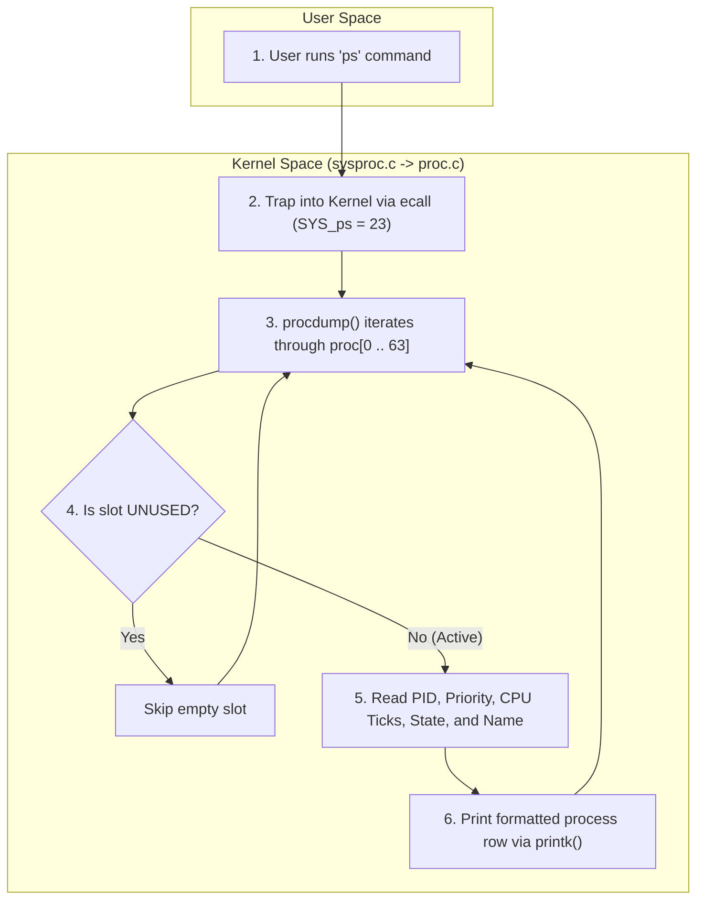

### Displayed Information

```text
PID   PRIORITY   CPU-TICKS   STATE     NAME
1     10         2           sleep     init
2     10         5           sleep     sh
3     10         0           run       ps
```

### Relevant Files

* `kernel/syscall.h`, `kernel/syscall.c`, `kernel/sysproc.c`, `kernel/proc.c`, `user/ps.c`

---

# 2. Priority-Based CPU Scheduler — `setpriority`

NexusXv6 replaces plain round-robin selection with a **priority-aware scheduler** supporting levels `1` (highest priority) through `20` (lowest priority). New processes start at default priority `10`.

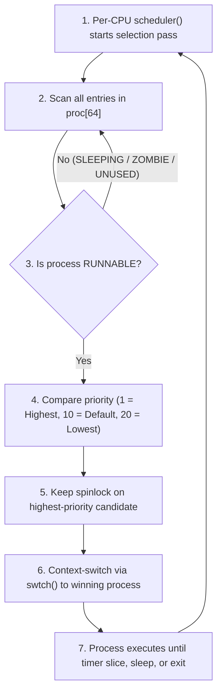

### Changing Priority

```text
$ setpriority 2 5
Process 2 priority set to 5
```

Values outside `1..20` are safely rejected with `-1` in `sys_setpriority()`.

### Relevant Files

* `kernel/proc.h`, `kernel/proc.c`, `kernel/sysproc.c`, `user/setpriority.c`

---

# 3. Per-Process CPU-Time Accounting

Every process tracks its cumulative execution ticks in `p->cpu_time` (initialized to `0` in `allocproc()`). Whenever a hardware timer interrupt preempts a running process, its counter increases by `1`.

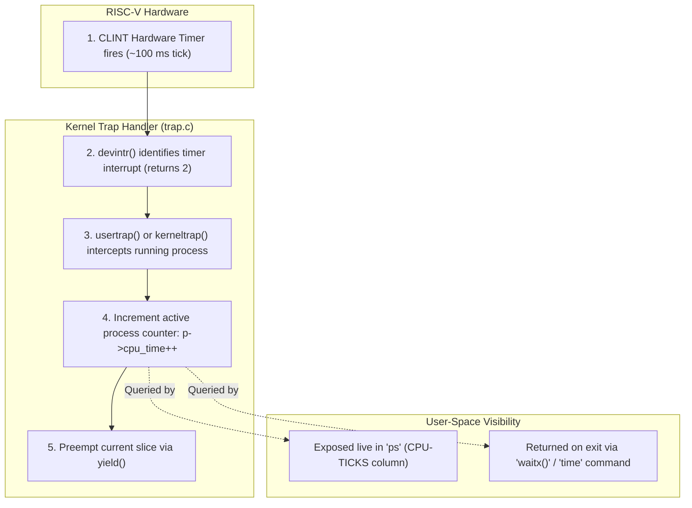

### Example

```text
$ cpuburn &
$ ps
PID   PRIORITY   CPU-TICKS   STATE     NAME
4     10         84          runble    cpuburn
```

### Relevant Files

* `kernel/proc.h`, `kernel/proc.c`, `kernel/trap.c`, `user/cpuburn.c`

---

# 4. Copy-on-Write (COW) Memory Management

During `fork()`, `uvmcopy()` avoids duplicating writable physical memory pages eagerly. Parent and child share the same physical frames marked read-only with `PTE_COW`, copying a page **only when either process writes to it**.

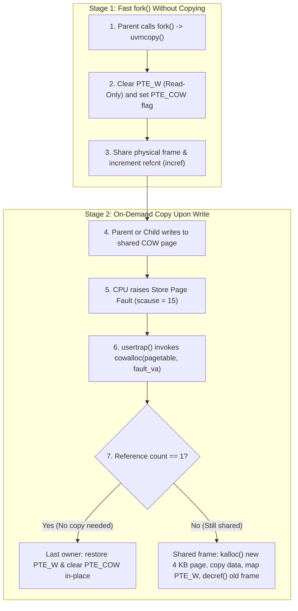

### Key Mechanisms

* **Frame Reference Counting (`kernel/kalloc.c`):** `incref()`, `getref()`, and `decref()` ensure physical pages return to the free list only when their reference count drops to `0`.
* **Safe Kernel Writes (`copyout()`):** Detects `PTE_COW` destinations and resolves them via `cowalloc()` before writing kernel data into user memory.

### Relevant Files

* `kernel/riscv.h`, `kernel/kalloc.c`, `kernel/vm.c`, `kernel/trap.c`, `user/cowtest.c`

---

# 5. Memory Mapping — `mmap()` and `munmap()`

NexusXv6 supports lazy, demand-paged file mappings using per-process Virtual Memory Areas (`struct vma vmas[16]`) with `PROT_READ`, `PROT_WRITE`, `MAP_SHARED`, and `MAP_PRIVATE`.

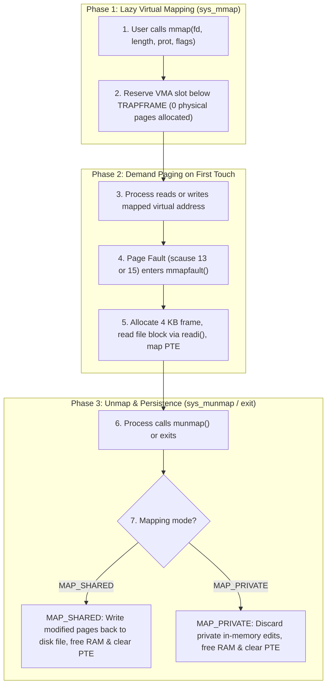

### Relevant Files

* `kernel/param.h`, `kernel/proc.h`, `kernel/proc.c`, `kernel/sysproc.c`, `kernel/vm.c`, `kernel/trap.c`, `user/mmaptest.c`

---

# 6. System Call Tracing — `trace()` and `strace`

Processes can trace specific or all system calls at runtime via `trace(uint64 mask)` (`SYS_trace = 27`). Because `p->trace_mask` is copied during `fork()`, `strace` seamlessly traces child commands and pipelines.

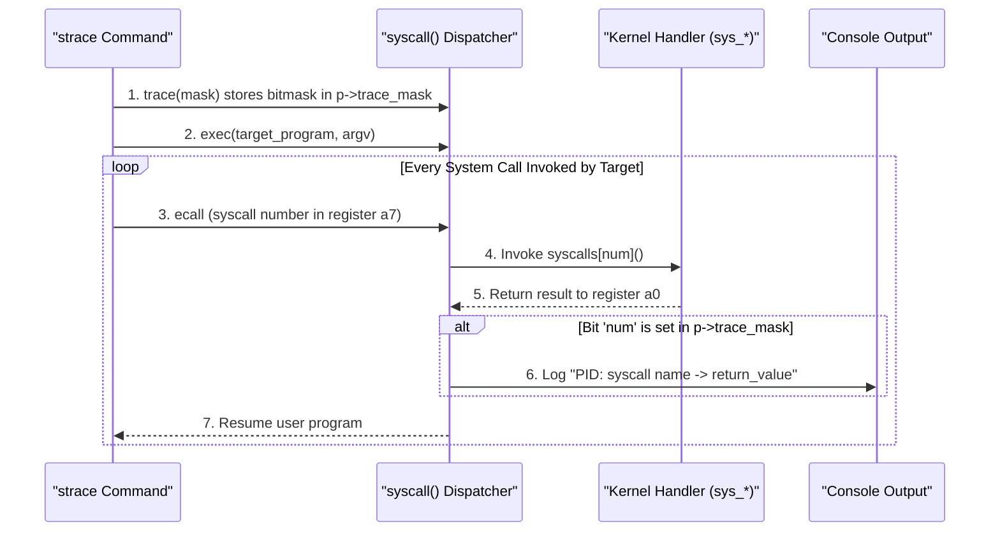

### Example

```text
$ strace -a echo hello
4: syscall exec -> 2
hello
4: syscall write -> 5
4: syscall write -> 1
```

### Relevant Files

* `kernel/proc.h`, `kernel/proc.c`, `kernel/syscall.h`, `kernel/syscall.c`, `kernel/sysproc.c`, `user/strace.c`

---

# 7. System Resource Diagnostics — `sysinfo()` and `free`

The `sysinfo(struct sysinfo *)` system call (`SYS_sysinfo = 28`) gathers live physical memory, process table, and uptime metrics from across the kernel into a single user-space snapshot.

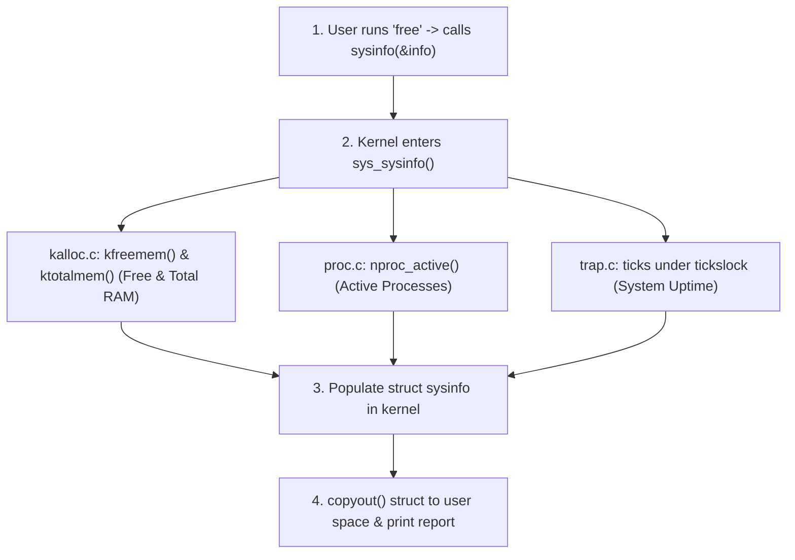

### Example

```text
$ free
Total memory:  130940 KB (32735 pages)
Used memory:   324 KB (81 pages)
Free memory:   130616 KB (32654 pages)
Active procs:  3 / 64
System uptime: 42 ticks
```

### Relevant Files

* `kernel/sysinfo.h`, `kernel/kalloc.c`, `kernel/proc.c`, `kernel/sysproc.c`, `user/free.c`

---

# 8. Parent Process Inspection — `getppid()` and `pstree`

NexusXv6 adds `getppid()` (`SYS_getppid = 29`) to query the caller's parent PID safely under `wait_lock`, and `ptree()` (`SYS_ptree = 30`) to snapshot the process table and render the live parent-child process tree.

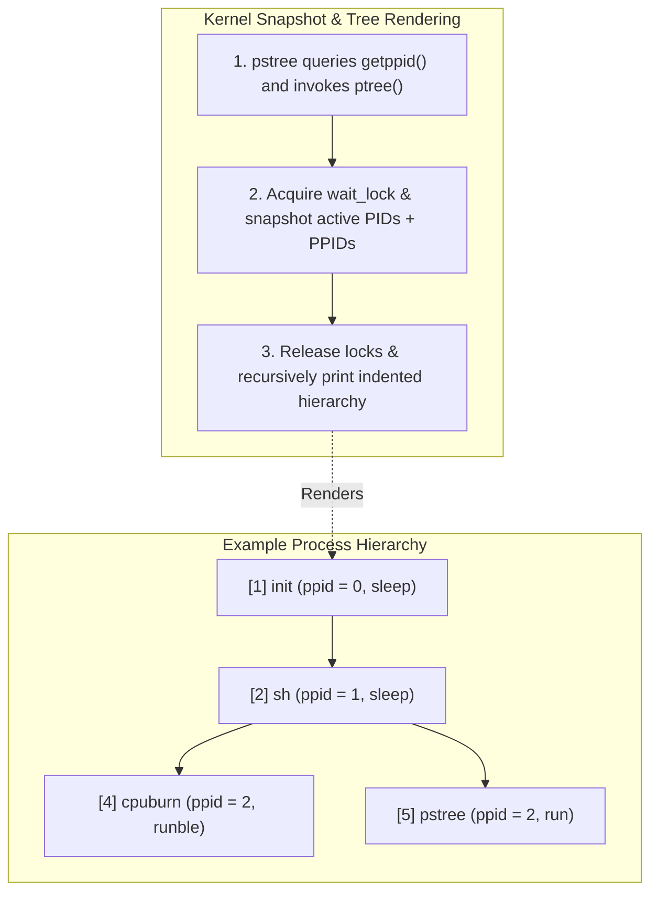

### Example

```text
$ pstree
Current PID: 5 | Parent PID: 2
Process Hierarchy:
[1] init (prio=10, state=sleep )
  |-- [2] sh (prio=10, state=sleep )
    |-- [5] pstree (prio=10, state=run   )
```

### Relevant Files

* `kernel/proc.c`, `kernel/sysproc.c`, `kernel/syscall.h`, `user/pstree.c`

---

# 9. Priority Aging for Starvation Prevention

Pure static priority scheduling can starve low-priority (`priority = 20`) processes when high-priority CPU-bound tasks stay runnable. NexusXv6 prevents starvation through **dynamic priority aging** inside `scheduler()`.

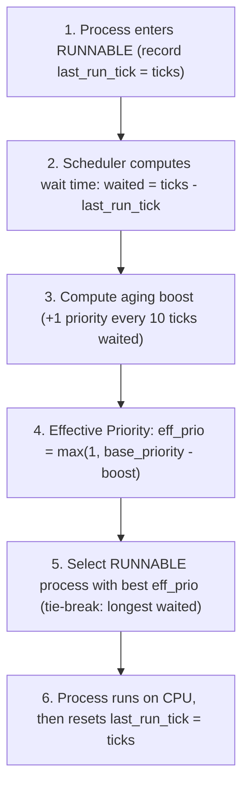

### Key Properties

* **Base priority preserved:** `p->priority` remains unchanged (`ps` continues showing the configured priority), while `eff_prio` temporarily improves the longer a runnable task waits.
* **Verified under SMP saturation:** `agetest` pins all CPU cores with `priority = 3` hogs and confirms a `priority = 20` worker still completes promptly.

### Relevant Files

* `kernel/param.h`, `kernel/proc.h`, `kernel/proc.c`, `user/agetest.c`

---

# 10. Per-Process System Call Accounting — `getsyscallcount()`

Every valid system call increments `p->syscall_count` in `syscall()`. User programs can inspect their own count (`getsyscallcount(0)`) or query any active PID (`getsyscallcount(pid)`, `SYS_getsyscallcount = 31`).

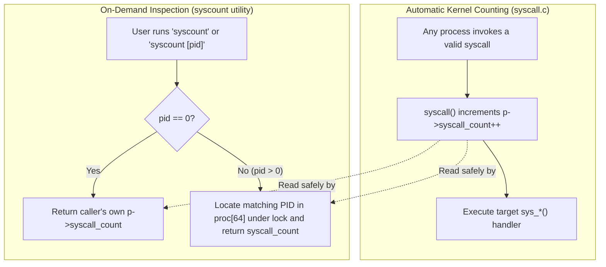

### Example

```text
$ syscount 2
Process 2 total syscalls: 28
```

### Relevant Files

* `kernel/proc.h`, `kernel/proc.c`, `kernel/syscall.c`, `kernel/sysproc.c`, `user/syscount.c`

---

# 11. Process Execution Benchmarking — `waitx()` and `time`

Each process records its creation tick (`p->ctime = ticks`) in `allocproc()`. The `waitx(&status, &wtime, &rtime)` system call (`SYS_waitx = 32`) reaps an exited child and reports both **CPU execution ticks (`rtime`)** and **waiting/sleeping ticks (`wtime`)**.

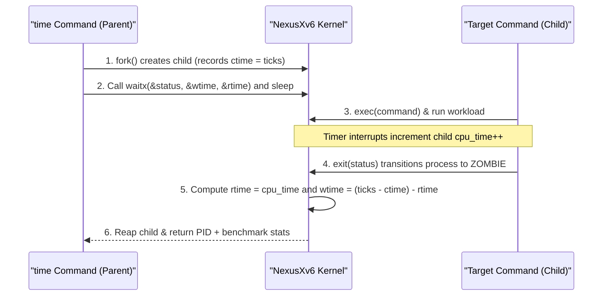

### Example

```text
$ time cowtest
Original: A
After child 1: A
After child 2: A
--- Benchmark: cowtest (PID 6) ---
Elapsed ticks: 3
CPU ticks:     1
Wait ticks:    2
Exit status:   0
```

### Relevant Files

* `kernel/proc.h`, `kernel/proc.c`, `kernel/sysproc.c`, `user/time.c`

---

# 12. Clean System Power Management — `halt()` and `reboot()`

NexusXv6 maps QEMU's SiFive test/power finisher device (`VIRT_TEST = 0x100000L`) into the kernel page table during `kvmmake()`. The `shutdown` and `reboot` commands flush disk buffers first via `sync()`, then signal QEMU cleanly via MMIO.

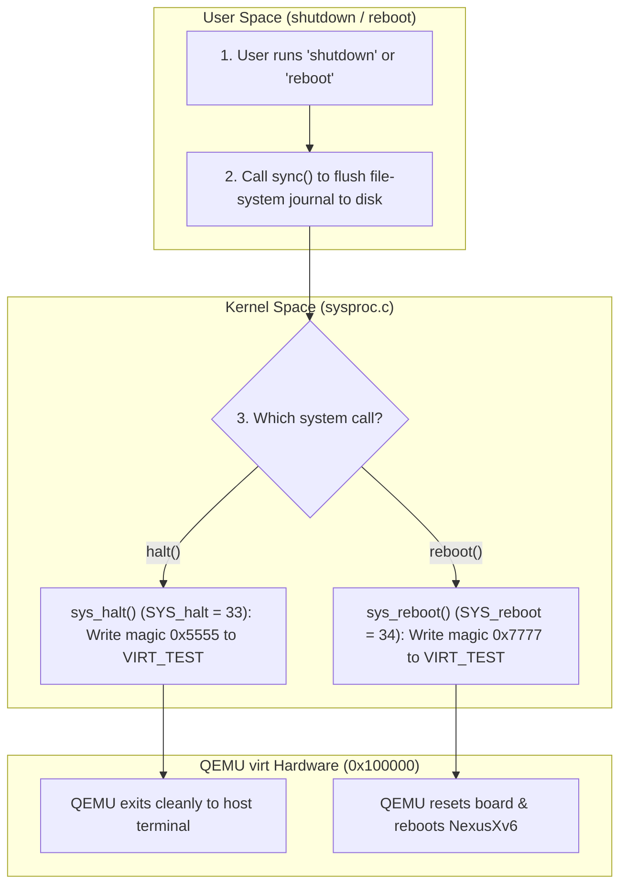

### Example

```text
$ shutdown
Shutting down NexusXv6...
System halting...
```

### Relevant Files

* `kernel/memlayout.h`, `kernel/vm.c`, `kernel/sysproc.c`, `user/shutdown.c`, `user/reboot.c`

---

# 13. Voluntary CPU Yielding — `sched_yield()`

The `sched_yield()` system call (`SYS_sched_yield = 35`) exposes cooperative scheduling to user space, allowing threads/workers to give up the remainder of their CPU time slice immediately without waiting for a hardware timer interrupt.

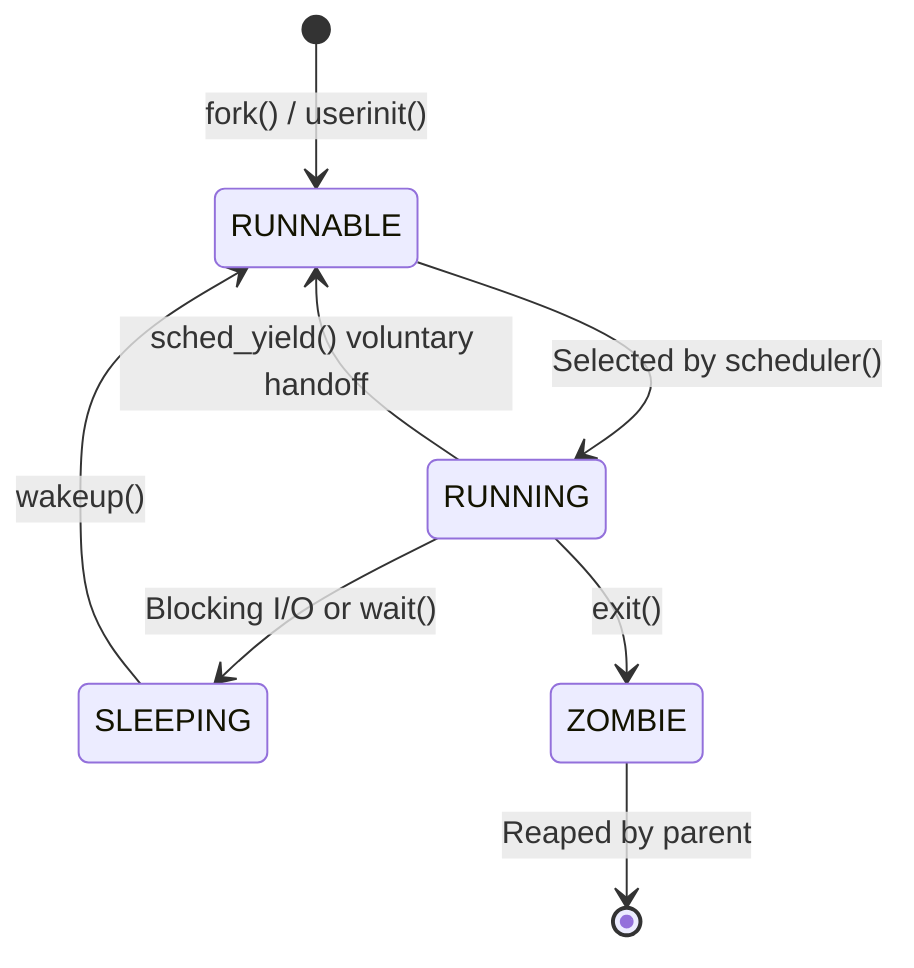

### Example

```text
$ yieldtest
yieldtest: starting cooperative CPU yield test
Worker A (PID 4): step 1 -> sched_yield()
Worker B (PID 5): step 1 -> sched_yield()
...
yieldtest: ALL TESTS PASSED
```

### Relevant Files

* `kernel/sysproc.c`, `kernel/proc.c`, `user/yieldtest.c`

---

# 14. Multi-Core HART Identification — `getcpuid()`

QEMU boots NexusXv6 as a symmetric multiprocessor (`CPUS = 3`: `hart 0`, `hart 1`, `hart 2`). The `getcpuid()` system call (`SYS_getcpuid = 36`) safely returns which physical RISC-V hardware thread is currently executing the calling process.

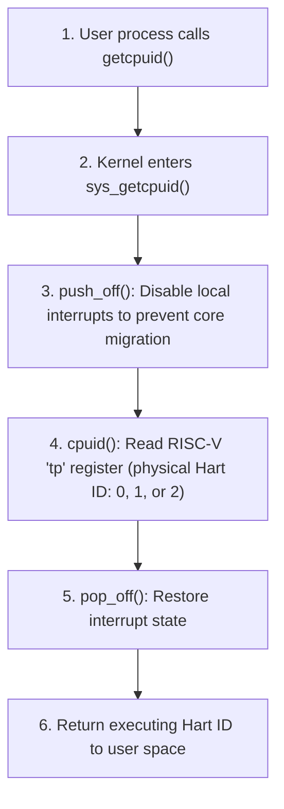

### Example

```text
$ cpuinfo
Parent (PID 4) running on RISC-V hart 0
Worker 0 (PID 5) executing on RISC-V hart 1
Worker 1 (PID 6) executing on RISC-V hart 2
Worker 2 (PID 7) executing on RISC-V hart 0
```

### Relevant Files

* `kernel/sysproc.c`, `kernel/proc.c`, `user/cpuinfo.c`

---

# 15. Dynamic Process Naming — `setprocname()`

The `setprocname(const char *name)` system call (`SYS_setprocname = 37`) allows worker processes and background services to assign themselves meaningful runtime names (up to 15 characters + NUL) visible in `ps` and `pstree`.

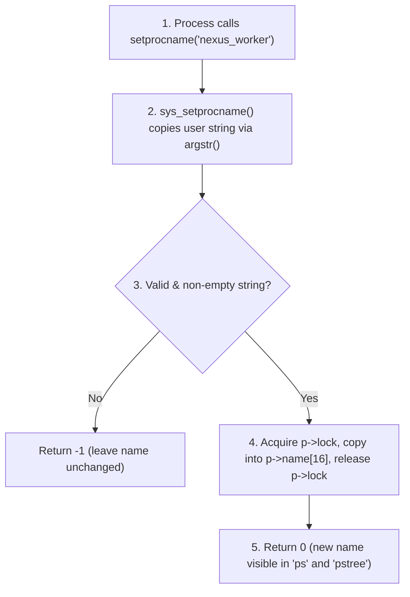

### Example

```text
$ renametest
renametest (PID 5): before setprocname()
...
5   10   0   run   renametest

renametest (PID 5): after setprocname("nexus_worker")
...
5   10   0   run   nexus_worker
renametest: ALL TESTS PASSED
```

### Relevant Files

* `kernel/sysproc.c`, `kernel/proc.h`, `user/renametest.c`

---

# 16. Random-Access File Positioning — `lseek()`

Baseline xv6 only supports sequential file reads and writes. NexusXv6 adds `lseek(int fd, int offset, int whence)` (`SYS_lseek = 38`), enabling random-access file positioning with `SEEK_SET` (`0`), `SEEK_CUR` (`1`), and `SEEK_END` (`2`).

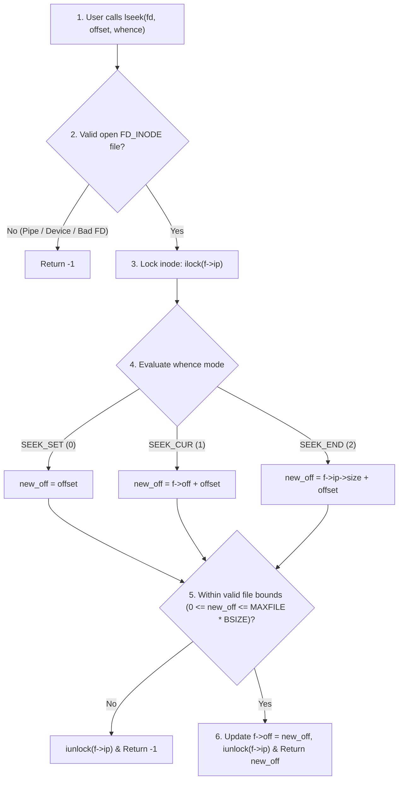

### Example

```text
$ lseektest
lseektest: starting random-access file positioning test
lseektest: SEEK_SET offset 4 -> patched 4 bytes
lseektest: SEEK_CUR offset 10 -> read "ABCD"
lseektest: SEEK_END -12 -> verified "WXYZ" (size=16)
lseektest: ALL TESTS PASSED
```

### Relevant Files

* `kernel/fcntl.h`, `kernel/syscall.h`, `kernel/syscall.c`, `kernel/sysfile.c`, `user/lseektest.c`

---

# 17. Symbolic Links — `symlink()` and `O_NOFOLLOW`

NexusXv6 introduces symbolic-link inodes (`T_SYMLINK = 4`) via `symlink(const char *target, const char *path)` (`SYS_symlink = 39`), shell support in `ln -s`, `ls` type recognition, `O_NOFOLLOW` raw inspection, and bounded cycle detection (`MAXSYMLINK = 10`).

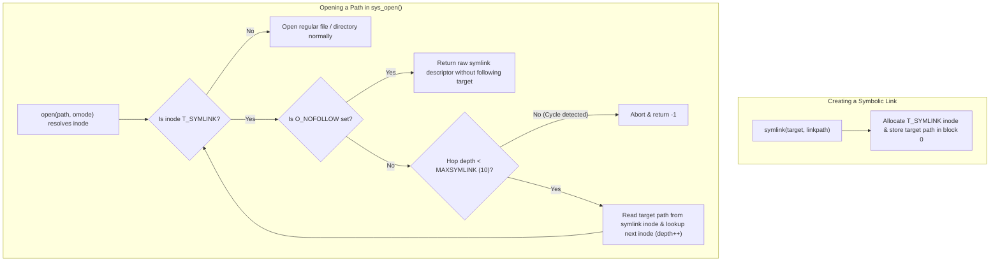

### Example

```text
$ symlinktest
symlinktest: starting symbolic link verification
symlinktest: chained resolution sym_link2 -> sym_link1 -> "nexus_symlink" OK
symlinktest: O_NOFOLLOW verified inode type T_SYMLINK (4)
symlinktest: cycle detection (MAXSYMLINK) OK
symlinktest: ALL TESTS PASSED
```

### Relevant Files

* `kernel/stat.h`, `kernel/fcntl.h`, `kernel/param.h`, `kernel/sysfile.c`, `user/ln.c`, `user/ls.c`, `user/symlinktest.c`

---

# 18. Periodic User-Space Timer Alarms — `sigalarm()` and `sigreturn()`

NexusXv6 supports periodic kernel-to-user timer upcalls via `sigalarm(int ticks, void (*handler)(void))` (`SYS_sigalarm = 40`) and `sigreturn()` (`SYS_sigreturn = 41`). The kernel preserves the interrupted user register state in `p->alarm_tf` and prevents re-entrant signal overlap via `p->alarm_active`.

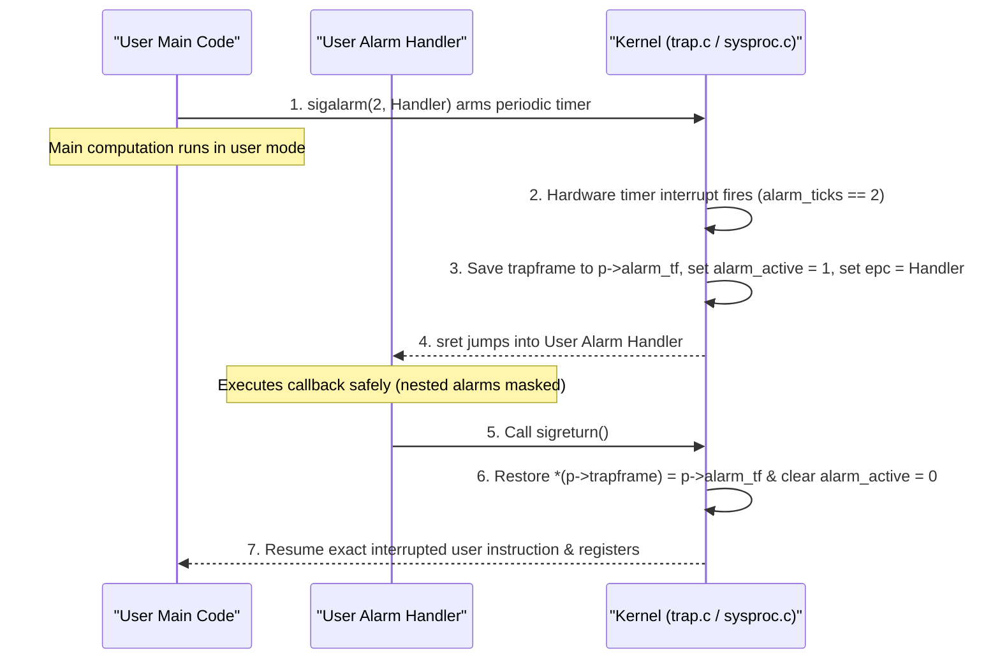

### Example

```text
$ alarmtest
alarmtest: configuring periodic timer (interval = 2 ticks)
alarmtest: timer signal #1 delivered to user handler
alarmtest: timer signal #2 delivered to user handler
alarmtest: timer signal #3 delivered to user handler
alarmtest: timer signal #4 delivered to user handler
alarmtest: register state verified across 4 signals
alarmtest: ALL TESTS PASSED
```

### Relevant Files

* `kernel/proc.h`, `kernel/proc.c`, `kernel/exec.c`, `kernel/trap.c`, `kernel/sysproc.c`, `user/alarmtest.c`

---

# 19. Targeted File Descriptor Redirection — `dup2()`

While baseline `dup()` only allocates the lowest free descriptor slot, `dup2(int oldfd, int newfd)` (`SYS_dup2 = 42`) atomically duplicates `oldfd` onto an exact target slot `newfd`, closing any previously open file at `newfd` first.

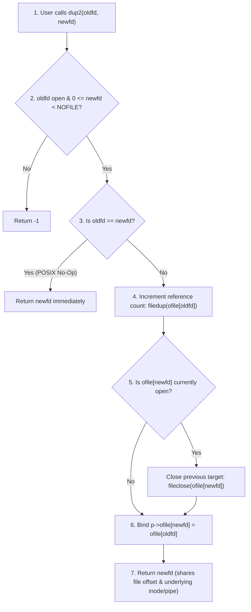

### Example

```text
$ dup2test
dup2test: starting targeted descriptor redirection test
dup2test: shared offset across fd 3 and fd 10 OK
dup2test: ALL TESTS PASSED
```

### Relevant Files

* `kernel/syscall.h`, `kernel/syscall.c`, `kernel/sysfile.c`, `user/dup2test.c`

---

# 20. File System & Disk Usage Diagnostics — `statfs()` and `df`

Complementing `free` for physical memory, `statfs(struct statfs *)` (`SYS_statfs = 43`) and the `df` command inspect live on-disk storage utilization across the VirtIO block filesystem via the kernel buffer cache.

```mermaid
flowchart TD
    U["1. User runs 'df' (or 'df -t') -> calls statfs(&st)"] --> K["2. Kernel enters sys_statfs() -> fsstat()"]

    K --> SB["Read Superblock (sb): block size, total blocks, data & log counts"]
    K --> BM["Scan Block Bitmap via bread(): count allocated vs. free disk blocks"]
    K --> IN["Scan On-Disk Inode Blocks (IBLOCK): count active vs. free inodes"]

    SB --> PACK["3. Populate struct statfs"]
    BM --> PACK
    IN --> PACK

    PACK --> OUT["4. copyout() to user space & display disk/inode report"]
```

### Example

```text
$ df -t
Filesystem (ROOTDEV 1, block size 1024 B):
Total disk:   4000 KB (4000 blocks, 3953 data, 31 log)
Used disk:    1792 KB (1792 blocks, 44%)
Free disk:    2208 KB (2208 blocks)
Inodes:       44 used / 199 total (155 free)

df: running allocation & reclamation verification...
df: ALL TESTS PASSED
```

### Relevant Files

* `kernel/statfs.h`, `kernel/defs.h`, `kernel/fs.c`, `kernel/sysfile.c`, `user/df.c`

---

# System Calls Added (23 – 43)

| System Call         | Number | Module | Purpose                                                |
| ------------------- | -----: | -----: | ------------------------------------------------------ |
| `ps()`              |     23 |      1 | Display active entries in the kernel process table     |
| `setpriority()`     |     24 |      2 | Change process scheduling priority (`1..20`)           |
| `mmap()`            |     25 |      5 | Create a lazy file-backed virtual memory mapping       |
| `munmap()`          |     26 |      5 | Unmap pages and write back `MAP_SHARED` modifications  |
| `trace()`           |     27 |      6 | Configure per-process system-call trace bitmask        |
| `sysinfo()`         |     28 |      7 | Query free/total RAM, active processes, and uptime     |
| `getppid()`         |     29 |      8 | Return calling process's parent PID                    |
| `ptree()`           |     30 |      8 | Display hierarchical parent-child process tree         |
| `getsyscallcount()` |     31 |     10 | Return per-process invoked system-call count           |
| `waitx()`           |     32 |     11 | Reap child and return wait ticks & active CPU ticks    |
| `halt()`            |     33 |     12 | Cleanly power off the QEMU RISC-V virtual machine      |
| `reboot()`          |     34 |     12 | Cleanly restart the QEMU RISC-V virtual machine        |
| `sched_yield()`     |     35 |     13 | Voluntarily yield the current CPU time slice           |
| `getcpuid()`        |     36 |     14 | Return executing RISC-V hardware thread (hart) ID      |
| `setprocname()`     |     37 |     15 | Dynamically update the calling process's name          |
| `lseek()`           |     38 |     16 | Reposition read/write file offset (`SEEK_SET/CUR/END`) |
| `symlink()`         |     39 |     17 | Create a symbolic link (`T_SYMLINK`) to a target path  |
| `sigalarm()`        |     40 |     18 | Register a periodic user-space timer alarm callback    |
| `sigreturn()`       |     41 |     18 | Restore saved trapframe after user alarm handler runs  |
| `dup2()`            |     42 |     19 | Atomically duplicate a file descriptor onto `newfd`    |
| `statfs()`          |     43 |     20 | Query disk block, log, and inode usage statistics      |

---

# Building & Running

NexusXv6 builds and runs on **WSL2 (Ubuntu)** with `build-essential`, `gcc-riscv64-unknown-elf`, `qemu-system-misc` / `qemu-system-riscv`, `perl`, and `bc`:

```bash
cd /mnt/d/xv6-riscv-riscv
make clean
make
make qemu
```

Inside the NexusXv6 shell (`$`):

```text
$ ps
$ pstree
$ free
$ df -t
$ setpriority 2 5
$ agetest
$ cowtest
$ mmaptest
$ strace -a echo hello
$ syscount
$ time cowtest
$ yieldtest
$ cpuinfo
$ renametest
$ lseektest
$ symlinktest
$ alarmtest
$ dup2test
$ usertests
$ shutdown
```

For step-by-step evaluator instructions and expected outputs for all 20 modules, see **[USER_MANUAL.md](USER_MANUAL.md)**.

---

# Documentation

* **[README.md](README.md)** — Architecture, clear Mermaid diagrams, and implementation details for all 20 kernel modules
* **[USER_MANUAL.md](USER_MANUAL.md)** — Step-by-step build, command reference, and verification guide
