# NexusXv6

### Extended xv6-RISC-V Operating System Kernel (20 Modules + Mini-Extensions)

### Group Members

| Member Name | Registration / Roll No. |
| :--- | :--- |
| **Muhammad Asbah Khan** | `BCS-F24-E01` |
| **Musfirah Chaudhry** | `BCS-F24-E31` |
| **Sahiba Bibi** | `BCS-F24-E14` |
| **Muhammad Shahbaz** | `BCS-F24-E13` |

---

## Overview

**NexusXv6** is an extended version of the MIT `xv6-riscv` teaching operating system kernel. It expands the baseline kernel with **20 modular kernel extensions**—each paired with a targeted **mini-extension**—spanning process & hierarchy inspection, priority scheduling with anti-starvation aging, CPU and system-call accounting, execution benchmarking, Copy-on-Write (COW) virtual memory, demand-paged and anonymous memory mappings, live system-call tracing, RAM & disk diagnostics, multi-core HART introspection & affinity, cooperative yielding, dynamic process naming, user-level timer signals, random-access file positioning, symbolic links, targeted descriptor redirection, and MMIO-driven power management.

The implementation targets **64-bit RISC-V (`rv64gc`)** and runs on **QEMU (`virt` machine, SMP)** under **WSL2 / Ubuntu**.

---

## Features (20 Kernel Modules & Mini-Extensions)

| # | Core Kernel Module | Mini-Extension (Additional Functionality) |
| -: | :--- | :--- |
| **1** | **Process list (`ps`)** | Shows each program's memory size (`MEM-KB`) and total memory used |
| **2** | **Priority CPU scheduler (`setpriority`)** | Check priority (`getpriority`) and use `pid = 0` to target yourself |
| **3** | **CPU time tracking (`cpuburn`)** | Splits CPU time into user work vs. kernel work (`U/K` ticks) |
| **4** | **Copy-on-Write memory (COW)** | Counts how many pages actually had to be copied (`cow_faults`) |
| **5** | **Memory mapping (`mmap` & `munmap`)** | Anonymous zero-filled memory (`MAP_ANONYMOUS`) without needing a file |
| **6** | **System call tracing (`strace`)** | Show only failed calls (`-e`) or print a summary table (`-c`) |
| **7** | **System health & memory (`free`)** | Megabyte view (`free -m`) plus open files & shared COW page counts |
| **8** | **Process family tree (`pstree`)** | Filter by a chosen root PID (`pstree <pid>`) and show child counts (`kids=N`) |
| **9** | **Anti-starvation priority aging (`agetest`)** | Live effective priority (`EFF`) in `ps` and runtime tuning (`agetest set`) |
| **10** | **Syscall counter (`syscount`)** | Ranked breakdown of top syscalls and errors (`syscount -v [pid]`) |
| **11** | **Command timer & benchmark (`time`)** | Shows CPU usage percentage (`CPU%`) and context switches |
| **12** | **Clean power control (`shutdown` & `reboot`)** | Optional countdown timer (`shutdown <sec>`) with console warning |
| **13** | **Voluntary CPU yielding (`sched_yield`)** | Tracks how many times each process gave up the CPU (`yield_count`) |
| **14** | **Multi-core CPU info (`cpuinfo`)** | Pin processes to specific RISC-V cores (`setaffinity`) |
| **15** | **Dynamic process naming (`setprocname`)** | Read back a process name (`getprocname`) and find PIDs (`pidof`) |
| **16** | **Jump anywhere in a file (`lseek`)** | Seeking past file end zero-fills the gap automatically |
| **17** | **Shortcuts / symbolic links (`symlink`)** | Inspect shortcut targets (`readlink`) and show `link -> target` in `ls` |
| **18** | **Timer alarms (`sigalarm` & `sigreturn`)** | One-shot alarms (`SIGALARM_ONESHOT`) and remaining-tick return value |
| **19** | **Redirect file handles (`dup2`)** | Auto-close private handles on `exec()` (`dup3` with `O_CLOEXEC`) |
| **20** | **Disk & cache health (`df`)** | Buffer cache hit/miss stats (`df -c`) and self-test (`df -t`) |

All twenty extensions preserve original xv6 interfaces and full compatibility with the standard `usertests` regression suite.

---

## Project Structure

```text
NexusXv6/
├── kernel/
│   ├── proc.h          # Process control block, VMA table, priority, aging, alarm & trace state
│   ├── proc.c          # Priority scheduler, aging, fork/exit, waitx, ps, pstree, syscount
│   ├── syscall.h       # System call numbers (1..53)
│   ├── syscall.c       # Syscall dispatch table, per-process counting, and strace logger
│   ├── sysproc.c       # Process, memory, benchmark, timer-alarm, CPU, and power syscalls
│   ├── sysfile.c       # VFS syscalls including lseek, symlink, O_NOFOLLOW, dup2/dup3, and statfs
│   ├── bio.c           # Buffer cache with hit/miss telemetry for df -c
│   ├── file.h          # Open file descriptor structs and sparse_pending tracking for lseek
│   ├── file.c          # File table helpers, nopen_files(), and sparse write zero-fill
│   ├── fs.c            # File system allocator, inodes, path lookup, and fsstat() scanner
│   ├── statfs.h        # struct statfs disk/inode diagnostics structure shared with user space
│   ├── sysinfo.h       # struct sysinfo memory/process structure shared with user space
│   ├── fcntl.h         # File control flags (O_NOFOLLOW, O_CLOEXEC) and seek modes (SEEK_SET/CUR/END)
│   ├── stat.h          # File and inode types including T_SYMLINK
│   ├── trap.c          # Timer tick accounting, user sigalarm delivery, COW & mmap page faults
│   ├── exec.c          # ELF loader with mmap_cleanup(), O_CLOEXEC auto-close, and alarm reset across exec()
│   ├── vm.c            # Page tables, COW fork/faults, mmap demand paging, VIRT_TEST MMIO map
│   ├── kalloc.c        # Physical page allocator, COW frame reference counts, free RAM metrics
│   ├── memlayout.h     # Physical/virtual memory layout including VIRT_TEST MMIO register
│   ├── riscv.h         # RISC-V CSR helpers and Sv39 PTE flags (including PTE_COW)
│   ├── param.h         # Kernel tunables, AGING_THRESHOLD, MAXSYMLINK, and mmap flags
│   └── defs.h          # Internal kernel subsystem prototypes
│
├── user/
│   ├── ps.c            # Module 1:  Process table & memory footprint viewer
│   ├── setpriority.c   # Module 2:  Scheduling priority query & configuration utility
│   ├── cpuburn.c       # Module 3:  CPU-bound workload generator
│   ├── cowtest.c       # Module 4:  Copy-on-Write fork & fault-counter verification test
│   ├── mmaptest.c      # Module 5:  Shared, private & anonymous mmap verification test
│   ├── strace.c        # Module 6:  Live & summary system-call tracer command
│   ├── free.c          # Module 7:  Physical RAM, open-file & process diagnostics viewer
│   ├── pstree.c        # Module 8:  Parent PID & subtree process hierarchy viewer
│   ├── agetest.c       # Module 9:  Anti-starvation priority aging verification test
│   ├── syscount.c      # Module 10: Per-process syscall total & frequency utility
│   ├── time.c          # Module 11: Command execution & CPU% benchmark utility (waitx)
│   ├── shutdown.c      # Module 12: Clean / countdown system power-off command
│   ├── reboot.c        # Module 12: Clean / countdown system restart command
│   ├── yieldtest.c     # Module 13: Cooperative CPU yielding & yield-count test
│   ├── cpuinfo.c       # Module 14: Multi-core RISC-V HART & affinity inspection utility
│   ├── renametest.c    # Module 15: Dynamic process naming & lookup verification test
│   ├── pidof.c         # Module 15: Find active process IDs by process name (findproc)
│   ├── lseektest.c     # Module 16: Random-access & sparse file seek verification test
│   ├── symlinktest.c   # Module 17: Symbolic link, readlink & cycle-detection test
│   ├── alarmtest.c     # Module 18: Periodic & one-shot user timer alarm test
│   ├── dup2test.c      # Module 19: Targeted & O_CLOEXEC descriptor redirection test
│   ├── df.c            # Module 20: Disk, inode & buffer-cache diagnostics utility
│   ├── ln.c            # Hard & symbolic link utility (supports ln -s)
│   ├── ls.c            # Directory & file listing utility (T_SYMLINK aware)
│   ├── user.h          # User-space system call & library declarations
│   └── usys.pl         # RISC-V ecall assembly stub generator
│
├── Makefile
├── README.md
└── USER_MANUAL.md
```

---

## System Architecture

NexusXv6 is organized into four clean layers. User-space utilities invoke kernel services through the RISC-V `ecall` system-call gateway or trigger hardware traps (timer interrupts and page faults), which dispatch into core kernel subsystems above the multi-core RISC-V / QEMU hardware.

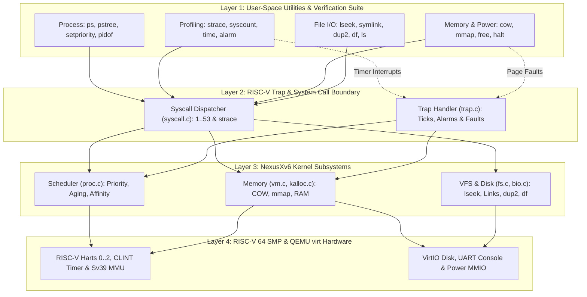

---

# 1. Process List — `ps`

### In Simple Words

`ps` works like a lightweight **Task Manager** inside our operating system. Whenever you run `ps`, the kernel checks all 64 process slots, skips the empty ones, and prints a clean, aligned table of every active program along with its priority, CPU time, memory size, state, and name.

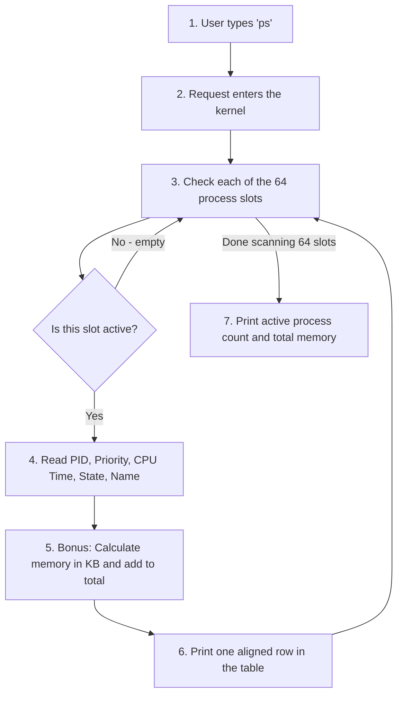

### How It Works

* **User command (`user/ps.c`):** Calls our `ps()` system call (`SYS_ps = 23`).
* **Kernel table scan (`kernel/proc.c`):** `procdump()` loops through all 64 slots in the process table, skips unused slots, and prints neat fixed-width columns so the output always lines up cleanly.
* **Safe for debugging:** `procdump()` also powers the `Ctrl+P` shortcut, so it reads process info without blocking on locks.

### Mini-Extension: Memory Size Column (`MEM-KB`) & Total Summary

* Converts each active process's memory size into kilobytes (`MEM-KB`) and adds a summary footer showing the **total number of active processes** and **total memory used**, making it easy to spot heavy programs at a glance.

### Live Demo & Output

```text
$ ps
PID   PRIO  EFF   CPU (U/K)       MEM-KB  STATE   NAME
----  ----  ----  --------------  ------  ------  ----------------
1     10    10    0 (0/0)         16      sleep   init
2     10    10    0 (0/0)         20      sleep   sh
3     10    10    0 (0/0)         16      run     ps
------------------------------------------------------------------
Active processes: 3 | Total process memory: 52 KB | Aging: 10 ticks
```

### Key Files

* `kernel/syscall.h`, `kernel/syscall.c`, `kernel/sysproc.c`, `kernel/proc.c`, `user/ps.c`

---

# 2. Priority-Based CPU Scheduler — `setpriority`

### In Simple Words

Default xv6 gives every ready program an equal turn (round-robin). Our priority scheduler lets **more important programs run first**. Every process gets a priority number from **1 (highest priority)** to **20 (lowest priority)**, starting at **10** by default. Whenever the CPU chooses the next task, it picks the ready process with the **smallest priority number**.

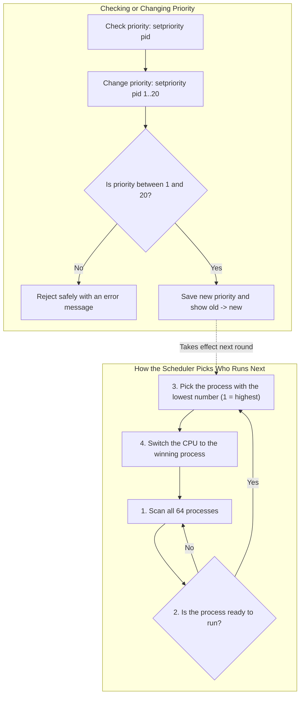

### How It Works

* **Every process stores a priority (`kernel/proc.h`):** New processes automatically start at priority `10` (`PRIO_DEFAULT`).
* **Smart selection (`kernel/proc.c`):** `scheduler()` checks every ready (`RUNNABLE`) process and gives the CPU to the one with the highest priority (lowest number).
* **Safe input checks (`kernel/sysproc.c`):** Any priority outside `1..20` or invalid PID is safely rejected without crashing the system.

### Mini-Extension: Check Priority (`getpriority`) & Self Shortcut (`pid = 0`)

* Adds a `getpriority(pid)` system call so you can check a process's priority anytime (`setpriority <pid>`), supports passing **`0`** to check or update your own process, and prints the **old → new** change clearly.

### Live Demo & Output

```text
$ setpriority 2
Process 2 current priority: 10

$ setpriority 2 5
Process 2 priority changed: 10 -> 5

$ setpriority 0
Process 6 (self) current priority: 10

$ setpriority 2 25
setpriority: failed (priority must be between 1 and 20)
```

### Key Files

* `kernel/param.h`, `kernel/proc.h`, `kernel/proc.c`, `kernel/sysproc.c`, `user/setpriority.c`

---

# 3. Per-Process CPU Time Tracking — `cpuburn`

### In Simple Words

The computer's hardware timer sends a short "tick" signal regularly (about 10 times per second). Whenever a tick arrives while a program is running on the CPU, our kernel adds **`+1`** to that program's CPU counter. This makes it easy to measure how much CPU time each program is using — and we also provide a `cpuburn` helper tool to generate CPU load during demos.

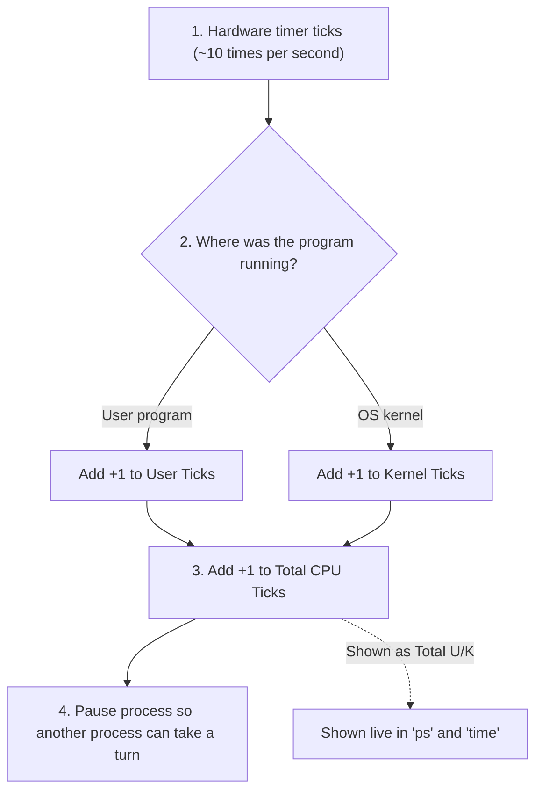

### How It Works

* **Starts at zero (`kernel/proc.c`):** When a process is created, its `cpu_time`, `user_ticks`, and `kernel_ticks` all start at `0`.
* **Counted on every timer tick (`kernel/trap.c`):** Every timer interrupt increments the running process's tick counters before yielding the CPU.
* **Easy demo tool (`user/cpuburn.c`):** Run `cpuburn &` in the background (prints its PID so you can stop it with `kill <pid>`) or run `cpuburn 2` for a quick finite demo.

### Mini-Extension: User vs. Kernel Tick Split (`U/K`)

* Separates CPU time into **User ticks** (time spent running the program's own code) and **Kernel ticks** (time spent inside OS system calls), displayed cleanly in `ps` as `Total (User/Kernel)`.

### Live Demo & Output

```text
$ cpuburn &
[cpuburn] PID 9 started (stop with 'kill 9')

$ ps
PID   PRIO  EFF   CPU (U/K)       MEM-KB  STATE   NAME
----  ----  ----  --------------  ------  ------  ----------------
1     10    10    0 (0/0)         16      sleep   init
2     5     5     0 (0/0)         20      sleep   sh
11    10    10    0 (0/0)         16      run     ps
9     10    10    3 (3/0)         16      run     cpuburn
------------------------------------------------------------------
Active processes: 4 | Total process memory: 68 KB | Aging: 10 ticks
```

### Key Files

* `kernel/proc.h`, `kernel/proc.c`, `kernel/trap.c`, `user/cpuburn.c`

---

# 4. Copy-on-Write (COW) Memory Management — `cowtest`

### In Simple Words

Normally, when a process creates a child with `fork()`, the OS immediately duplicates all of the parent's memory — even if the child never modifies it. **Copy-on-Write (COW)** works like two students sharing one textbook: both can read the same pages for free, and a personal photocopy is made **only when someone tries to write notes on a page**. This makes `fork()` much faster and saves RAM.

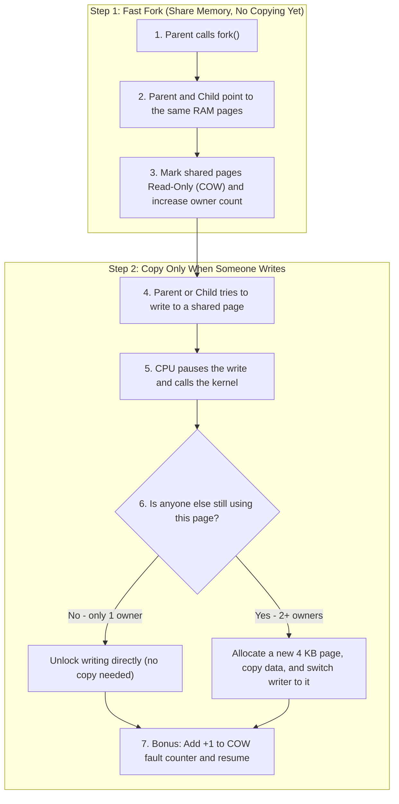

### How It Works

* **Owner counting (`kernel/kalloc.c`):** Every 4 KB physical page tracks how many processes share it (`incref`, `getref`, `decref`). A page is only freed when its owner count drops to `0`.
* **Fast sharing & safe writes (`kernel/vm.c`, `kernel/trap.c`):** `uvmcopy()` shares pages read-only with a `PTE_COW` tag; on the first write, `cowalloc()` makes a private writable copy and flushes the TLB.
* **Kernel write protection (`copyout()`):** Even when the OS writes into user memory (for example, during a `pipe` `read()`), `copyout()` checks for `PTE_COW` and makes a private copy so the parent's memory is never corrupted.

### Mini-Extension: Live COW Fault Counter (`getcowfaults`)

* Every time `cowalloc()` resolves a write on a shared page, it increments `p->cow_faults`. Programs (like `cowtest`) can query this count via `getcowfaults()` to prove that **reading shared memory causes `0` copies**, while **writing triggers a copy on demand**.

### Live Demo & Output

```text
$ cowtest
cowtest: starting Copy-on-Write verification
[Test 1] Child read 'S' -> new COW faults: 0 (page stayed shared)
[Test 2] Original: A
         Child 1 wrote 'B' -> new COW faults: 1
         After child 1: A (parent unchanged)
         Child 2 wrote 'C' -> new COW faults: 1
         After child 2: A (parent unchanged)
[Test 3] Kernel copyout wrote 'K' into child -> new COW faults: 1
         Parent still sees 'P' (protected from kernel copyout)
cowtest: ALL TESTS PASSED
```

### Key Files

* `kernel/riscv.h`, `kernel/kalloc.c`, `kernel/vm.c`, `kernel/trap.c`, `kernel/proc.c`, `user/cowtest.c`

---

# 5. Memory Mapping — `mmap()` and `munmap()`

### In Simple Words

Instead of calling `read()` and `write()` repeatedly to work with a file, `mmap()` lets a program **treat a file like a normal array in memory**. Even better, it loads pages **lazily**: calling `mmap()` only reserves an address range and uses zero RAM at first — the kernel loads a 4 KB page from disk only at the exact moment your program touches it.

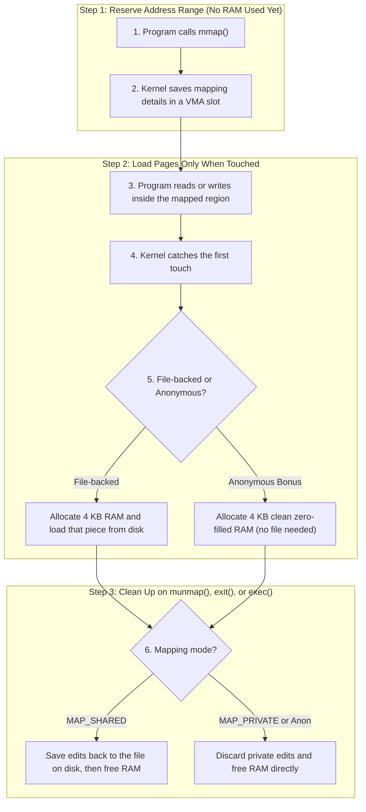

### How It Works

* **Two file modes (`kernel/sysproc.c`, `kernel/vm.c`):**
  * **`MAP_SHARED`:** Any edits you make in memory are automatically written back to the file when you call `munmap()` (or exit).
  * **`MAP_PRIVATE`:** Any edits stay private to your process — the file on disk stays untouched.
* **Lazy page loading (`kernel/trap.c`, `kernel/vm.c`):** `mmapfault()` allocates and maps one 4 KB page at a time only when accessed, checking read/write permissions first.
* **Automatic cleanup (`kernel/proc.c`, `kernel/exec.c`):** `mmap_cleanup()` ensures mapped pages are always unmapped and saved cleanly when a process exits or calls `exec()`.

### Mini-Extension: Anonymous Zero-Filled Memory (`MAP_ANONYMOUS`)

* Allows calling `mmap()` with `MAP_ANONYMOUS` and `fd = -1` to get clean, zero-filled memory pages on demand **without opening or creating any file on disk**.

### Live Demo & Output

```text
$ mmaptest
mmaptest: starting memory-mapping verification
[Test 1] MAP_SHARED mapped at 0x0000003FFFFFD000
         Edited 'hello' -> 'Hello' (saved to disk on munmap)
[Test 2] MAP_PRIVATE mapped at 0x0000003FFFFFD000
         Changed memory to 'Xello', disk still has 'Hello' (isolated)
[Test 3] MAP_ANONYMOUS (2 pages) mapped at 0x0000003FFFFFC000
         Verified 8 KB zero-filled memory without a disk file
mmaptest: ALL TESTS PASSED
```

### Key Files

* `kernel/param.h`, `kernel/proc.h`, `kernel/proc.c`, `kernel/sysproc.c`, `kernel/vm.c`, `kernel/trap.c`, `kernel/exec.c`, `user/mmaptest.c`

---

# 6. System Call Tracing — `trace()` and `strace`

### In Simple Words

When debugging a program, it helps to see **every request it sends to the operating system** (like opening files, reading, writing, or creating processes). `strace` acts like a live activity log for a command: you run `strace` in front of any program and watch every system call and its return value — without changing a single line of that program's code.

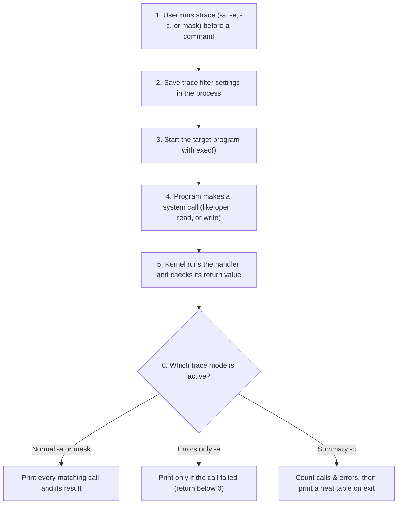

### How It Works

* **Tracing rule stays across `fork()` and `exec()` (`kernel/proc.c`):** Once `strace` enables tracing, the target command (and any child processes it spawns) inherits the trace rule automatically.
* **Single checkpoint (`kernel/syscall.c`):** Every system call passes through `syscall()`, so one central check logs the syscall name and return value cleanly.
* **Safe bitmask & mode setup (`user/strace.c`):** Supports `-a` for all calls, `-e` for errors only, `-c` for a summary table, or any decimal bitmask number.

### Mini-Extension: Error-Only Filter (`strace -e`) & Summary Table (`strace -c`)

* **`strace -e`:** Hides all successful calls and prints **only failing system calls** (`result < 0`), making missing files or bad arguments jump out immediately.
* **`strace -c`:** Collects counts quietly while the program runs and prints a **ranked summary table** of total calls and errors when the program exits.

### Live Demo & Output

```text
$ strace -e cat no_such_file
4: syscall open -> -1
cat: cannot open no_such_file

$ strace -c echo hello
hello

--- strace summary (PID 5: echo) ---
SYSCALL           CALLS   ERRORS
----------------  ------  ------
write             2       0
exec              1       0
exit              1       0
--------------------------------
Total syscalls: 4 | Total errors: 0
```

### Key Files

* `kernel/param.h`, `kernel/proc.h`, `kernel/proc.c`, `kernel/syscall.h`, `kernel/syscall.c`, `kernel/sysproc.c`, `user/strace.c`

---

# 7. System Health & Memory Diagnostics — `sysinfo()` and `free`

### In Simple Words

`free` gives you an instant **system health check** — similar to checking RAM and open apps on your computer. With a single `sysinfo()` call, the kernel gathers live memory stats, shared pages, open files, active processes, and system uptime, then prints them in an easy-to-read summary.

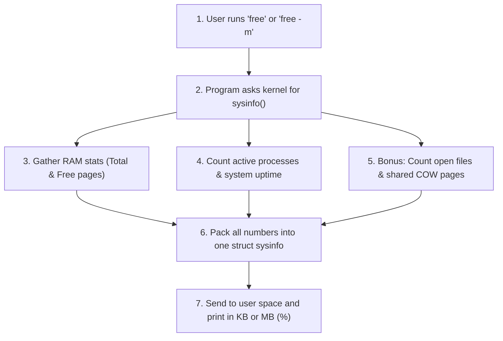

### How It Works

* **RAM & shared page check (`kernel/kalloc.c`):** `ktotalmem()` and `kfreemem()` measure total and free memory, while `ksharedpages()` counts pages currently shared via Copy-on-Write.
* **Kernel table counts (`kernel/proc.c`, `kernel/file.c`):** `nproc_active()` counts running/sleeping processes, and `nopen_files()` counts open file handles in the system file table.
* **Clean user formatting (`user/free.c`):** Calculates memory used and prints percentages cleanly (`<1%` when tiny but non-zero).

### Mini-Extension: Megabyte View (`free -m`) & Extra Kernel Metrics

* Adds **`free -m`** to display RAM in megabytes alongside the usage percentage, and expands `struct sysinfo` to report **Shared COW pages** and **Open files (`used / 100`)**.

### Live Demo & Output

```text
$ free
Total memory:  128668 KB (32167 pages)
Used memory:   804 KB (201 pages, <1%)
Free memory:   127864 KB (31966 pages)
Shared COW:    0 pages | Open files: 1 / 100
Active procs:  3 / 64  | Uptime: 2 ticks

$ free -m
Total memory:  126 MB (32167 pages)
Used memory:   1 MB (201 pages, <1%)
Free memory:   125 MB (31966 pages)
Shared COW:    0 pages | Open files: 1 / 100
Active procs:  3 / 64  | Uptime: 3 ticks
```

### Key Files

* `kernel/sysinfo.h`, `kernel/kalloc.c`, `kernel/file.c`, `kernel/proc.c`, `kernel/sysproc.c`, `user/free.c`

---

# 8. Process Family Tree — `getppid()` and `pstree`

### In Simple Words

Every process (except the very first `init` process) is created by a parent process using `fork()`. `pstree` draws a visual **family tree** showing who started whom — for example, `init` starts the shell `sh`, and `sh` starts whatever command you just typed. Each process also shows how many direct children it currently has.

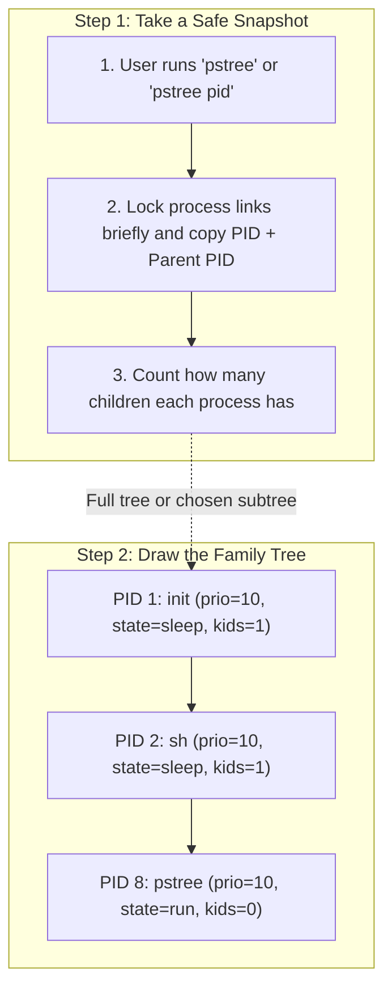

### How It Works

* **Safe parent lookup (`kernel/proc.c`):** `kgetppid()` uses `wait_lock` to safely read the parent's PID without race conditions.
* **Snapshot before printing (`proctree()`):** Copies active processes into a temporary buffer under `wait_lock`, releases the locks, and then prints the indented tree cleanly.
* **No ugly padding or missing counts:** Cleanly formats process states (`sleep`, `run`, `runble`) and shows `kids=N` on every line.

### Mini-Extension: Subtree Filter (`pstree <pid>`) & Child Count Badge

* Lets you pass a PID (such as **`pstree 2`**) to focus only on that process and its descendants, and displays **`kids=N`** next to every process so you can immediately see which processes spawned children.

### Live Demo & Output

```text
$ pstree
Current PID: 8 | Parent PID: 2
Process Hierarchy:
[1] init (prio=10, state=sleep, kids=1)
  |-- [2] sh (prio=10, state=sleep, kids=1)
    |-- [8] pstree (prio=10, state=run, kids=0)

$ pstree 2
Current PID: 9 | Parent PID: 2
Subtree Root PID: 2 (kids=1)
[2] sh (prio=10, state=sleep, kids=1)
  |-- [9] pstree (prio=10, state=run, kids=0)
```

### Key Files

* `kernel/proc.c`, `kernel/sysproc.c`, `kernel/syscall.h`, `user/pstree.c`

---

# 9. Priority Aging (Starvation Prevention) — `agetest`

### In Simple Words

In a strict priority scheduler, a low-priority program (`priority = 20`) might **wait forever ("starve")** if high-priority programs (`priority = 3`) keep hogging all the CPU cores. **Priority aging** solves this fairly: the longer a ready process waits in line, the better its *temporary* priority becomes — just like a ticket queue where waiting customers gradually move up until it is their turn.

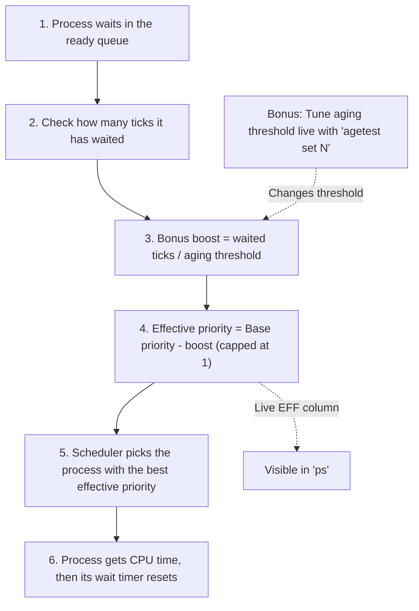

### How It Works

* **Original priority stays intact (`kernel/proc.c`):** `p->priority` never permanently changes — only the temporary `eff_prio` improves while the process is waiting (`RUNNABLE`).
* **Fair tie-breaking:** If two processes have the same effective priority, the one that has waited longer wins.
* **Stress-tested (`user/agetest.c`):** Launches 4 high-priority CPU hogs (`prio = 3`) across all CPU cores plus 1 low-priority worker (`prio = 20`) and confirms the low-priority worker still finishes promptly.

### Mini-Extension: Live `EFF` Column in `ps` & Runtime Tuning (`setaging`)

* Shows each process's live **effective priority (`EFF`)** right next to its base priority (`PRIO`) in `ps`, and adds **`setaging(ticks)`** (usable via `agetest get` / `agetest set <ticks>`) to adjust how fast waiting processes get boosted without recompiling.

### Live Demo & Output

```text
$ agetest
agetest: starting priority aging verification
[Test 1] Runtime setaging() verified (current threshold: 10 ticks)
[Test 2] Starting 4 high-priority hogs (prio 3) and 1 low-priority worker (prio 20)
         Low-priority worker (PID 16, prio 20) completed without starvation
agetest: ALL TESTS PASSED

$ agetest set 5
Aging threshold changed: 10 -> 5 ticks
```

### Key Files

* `kernel/param.h`, `kernel/proc.h`, `kernel/proc.c`, `kernel/sysproc.c`, `user/agetest.c`

---

# 10. Per-Process System Call Counter — `getsyscallcount()` and `syscount`

### In Simple Words

Every time a program asks the kernel to do something — read a file, print text, or check its PID — our kernel ticks up a counter for that process. `syscount` lets you check **how many total system calls a process has made**, and with `-v`, it even ranks **which system calls that program used the most**.

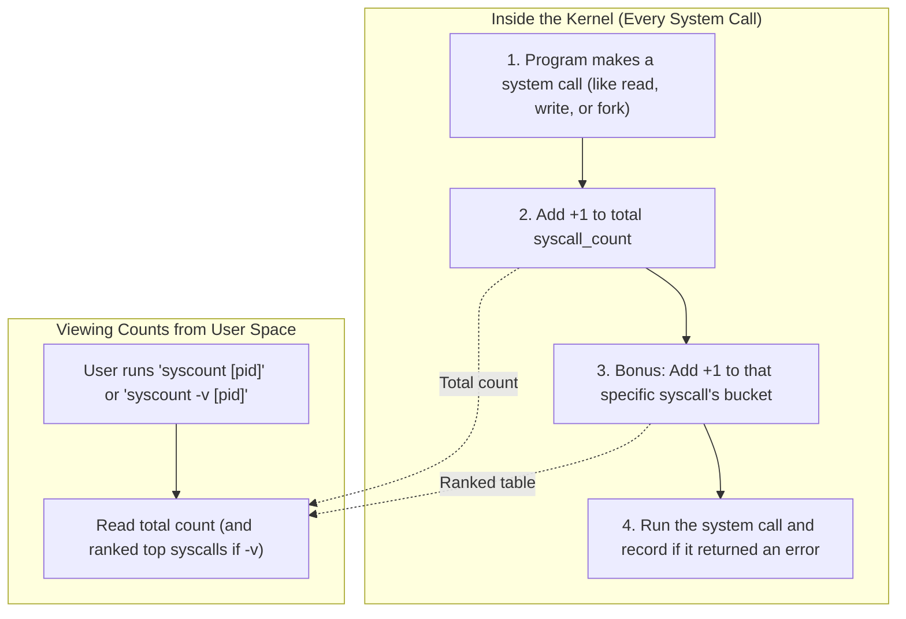

### How It Works

* **Zero overhead tracking (`kernel/syscall.c`):** Inside `syscall()`, valid calls simply increment `p->syscall_count` and `p->syscall_freq[num]`.
* **Safe per-process snapshot (`kernel/proc.c`):** `getsyscall_snapshot()` copies a process's counters under `p->lock` so live shells like `sh` can be inspected safely.
* **Three easy modes (`user/syscount.c`):** Run `syscount` for a quick self-test (`5x getpid()`), `syscount <pid>` for a total count, or `syscount -v <pid>` for the ranked table.

### Mini-Extension: Ranked Syscall Breakdown (`syscount -v`)

* Tracks per-syscall call and error counts inside `struct proc` so **`syscount -v [pid]`** prints the **top 5 most-used syscalls** plus a sorted breakdown table showing `SYSCALL`, `CALLS`, and `ERRORS`.

### Live Demo & Output

```text
$ syscount
PID 20 syscall count before 5x getpid(): 3
PID 20 syscall count after  5x getpid(): 9

$ syscount -v 2
Process 2 (sh) total syscalls: 231
Top syscalls: read (183), wait (15), fork (15), write (15), open (1)

SYSCALL           CALLS   ERRORS
----------------  ------  ------
read              183     0
wait              15      0
fork              15      0
write             15      0
open              1       0
exec              1       0
close             1       0
--------------------------------
```

### Key Files

* `kernel/param.h`, `kernel/proc.h`, `kernel/proc.c`, `kernel/syscall.h`, `kernel/syscall.c`, `kernel/sysproc.c`, `user/syscount.c`

---

# 11. Command Benchmarking — `waitx()` and `time`

### In Simple Words

`time` acts like a **stopwatch** for any command you run. It starts the program, waits for it to finish, and prints how long it ran in total, how many ticks it actually spent using the CPU vs. waiting, how many times the scheduler switched it onto a CPU, and its exit code.

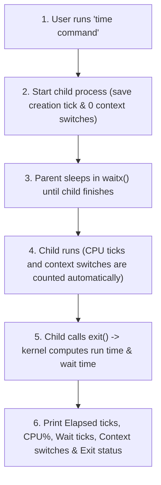

### How It Works

* **Creation timestamp (`kernel/proc.c`):** `allocproc()` records `p->ctime = ticks` and clears `p->ctx_switches = 0`.
* **Context-switch tracking (`scheduler()`):** Every time `scheduler()` picks a process and runs `swtch()`, `best->ctx_switches++` increases by 1.
* **Report on exit (`kwaitx()`, `user/time.c`):** Returns wait ticks (`total - cpu_time`), active CPU ticks, and context switches so `time` can compute `CPU%`.

### Mini-Extension: CPU Percentage (`CPU%`) & Context Switches

* Shows **`CPU%` (`(CPU ticks * 100) / Elapsed ticks`)** so you can immediately tell if a command is CPU-heavy or mostly waiting, alongside the exact **context switch count**.

### Live Demo & Output

```text
$ time cpuburn 2
[cpuburn] PID 4 running 2 busy rounds...
[cpuburn] PID 4 finished 2 rounds

--- Benchmark: cpuburn (PID 4) ---
Elapsed ticks:    3
CPU ticks:        3 (100% CPU)
Wait ticks:       0
Context switches: 8
Exit status:      0
```

### Key Files

* `kernel/proc.h`, `kernel/proc.c`, `kernel/sysproc.c`, `user/time.c`

---

# 12. Clean Power Management — `shutdown` and `reboot`

### In Simple Words

Instead of forcing QEMU to quit with keyboard shortcuts (`Ctrl+A`, `X`), our `shutdown` and `reboot` commands **flush all pending disk writes safely first** via `sync()`, then send a clean power-off or restart signal directly to the virtual machine hardware.

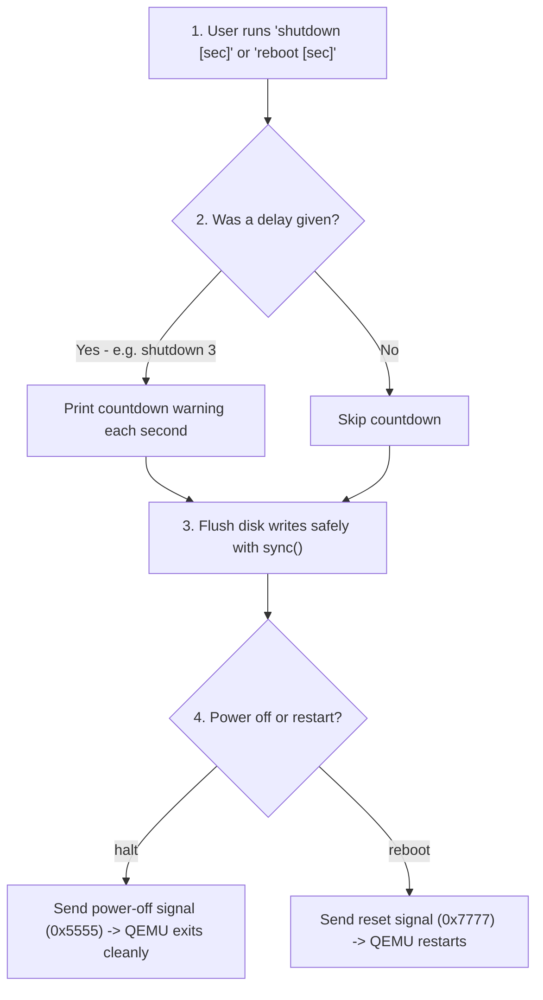

### How It Works

* **Hardware power register mapped (`kernel/vm.c`):** `kvmmake()` maps QEMU's power control address (`VIRT_TEST = 0x100000`) so the kernel can talk to the virtual board directly.
* **Disk safety first (`user/shutdown.c`, `user/reboot.c`):** Always calls `sync()` to flush the file system log before halting or rebooting.

### Mini-Extension: Timed Countdown Warning (`shutdown <sec>` / `reboot <sec>`)

* Supports an optional delay in seconds (for example, `shutdown 1` or `reboot 3`) that broadcasts a countdown warning on the console before flushing disks and powering off.

### Live Demo & Output

```text
$ shutdown 1
Broadcast: NexusXv6 shutting down in 1 second(s)...
  shutting down in 1...
Flushing filesystems...
Shutting down NexusXv6...
System halting...
```

### Key Files

* `kernel/memlayout.h`, `kernel/vm.c`, `kernel/sysproc.c`, `user/shutdown.c`, `user/reboot.c`

---

# 13. Voluntary CPU Yielding — `sched_yield()`

### In Simple Words

Normally a running process keeps the CPU until a hardware timer interrupts it or it waits for I/O. `sched_yield()` lets a cooperative program **politely hand the CPU over to someone else right away** when it reaches a good stopping point.

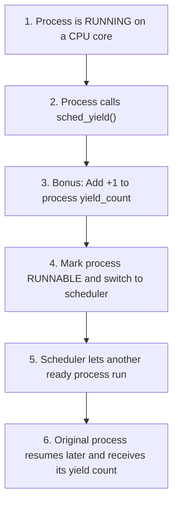

### How It Works

* **Instant polite handoff (`kernel/sysproc.c`):** `sys_sched_yield()` increments `p->yield_count`, calls `yield()`, and returns the updated voluntary yield count to user space.
* **Verified alternating turns (`user/yieldtest.c`):** Two workers (`Worker A` and `Worker B`) take turns calling `sched_yield()` three times each and confirm `6` total voluntary yields.

### Mini-Extension: Voluntary Yield Counter (`yield_count`)

* Tracks `p->yield_count` inside `struct proc` and returns it from `sched_yield()` so programs can count voluntary handoffs separately from timer preemptions.

### Live Demo & Output

```text
$ yieldtest
yieldtest: starting cooperative CPU yield test
Worker A (PID 6): step 1 -> sched_yield() (voluntary yields = 1)
Worker B (PID 7): step 1 -> sched_yield() (voluntary yields = 1)
Worker A (PID 6): step 2 -> sched_yield() (voluntary yields = 2)
Worker B (PID 7): step 2 -> sched_yield() (voluntary yields = 2)
Worker A (PID 6): step 3 -> sched_yield() (voluntary yields = 3)
Worker B (PID 7): step 3 -> sched_yield() (voluntary yields = 3)
yieldtest: ALL TESTS PASSED (6 total voluntary yields verified)
```

### Key Files

* `kernel/proc.h`, `kernel/proc.c`, `kernel/sysproc.c`, `user/yieldtest.c`

---

# 14. Multi-Core CPU Identification & Affinity — `getcpuid()` and `cpuinfo`

### In Simple Words

QEMU runs NexusXv6 on **3 RISC-V CPU cores (harts `0`, `1`, and `2`)** at the same time. `getcpuid()` tells a program **which exact CPU core it is currently running on**, and `setaffinity()` lets a program **pin itself to specific cores** (just like assigning a worker to a specific desk).

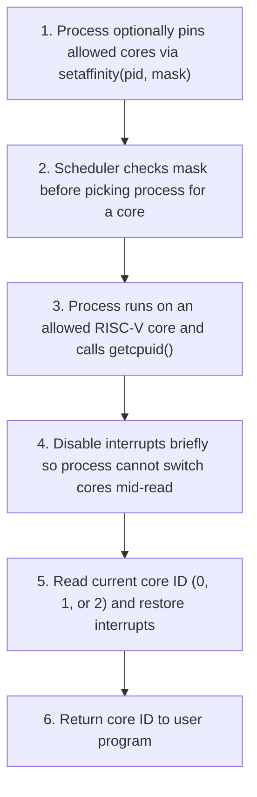

### How It Works

* **Interrupt-safe read (`kernel/sysproc.c`):** `sys_getcpuid()` wraps `cpuid()` in `push_off()` / `pop_off()` so the process cannot migrate to another core while reading its hart ID.
* **Online core validation (`kernel/proc.c`):** `scheduler()` records all booted cores in `online_cpus`, so `setaffinity()` safely rejects invalid core masks (like `0x8000`).

### Mini-Extension: CPU Core Affinity Pinning (`setaffinity`)

* Stores a per-process `p->cpu_affinity` bitmask checked by `scheduler()`. Calling `setaffinity(pid, mask)` pins a process to chosen harts (`0x1` = hart 0, `0x2` = hart 1, `0x4` = hart 2) and immediately migrates it if needed.

### Live Demo & Output

```text
$ cpuinfo
Parent (PID 8) running on RISC-V hart 1 (online mask=0x7)
Worker 0 (PID 9, mask=0x1) executing on RISC-V hart 0
Worker 1 (PID 10, mask=0x2) executing on RISC-V hart 1
Worker 2 (PID 11, mask=0x4) executing on RISC-V hart 2
cpuinfo: ALL TESTS PASSED
```

### Key Files

* `kernel/proc.h`, `kernel/proc.c`, `kernel/syscall.h`, `kernel/syscall.c`, `kernel/sysproc.c`, `user/cpuinfo.c`

---

# 15. Dynamic Process Naming — `setprocname()` and `pidof`

### In Simple Words

When a parent process forks worker children, every child initially inherits the parent's name. `setprocname()` lets a running process **give itself a clear custom name** (like `"nexus_worker"`), which immediately updates in `ps` and `pstree` and can be searched by name with `pidof`.

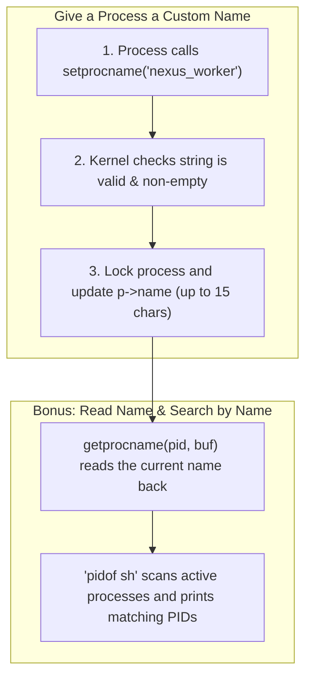

### How It Works

* **Thread-safe name update (`kernel/sysproc.c`):** `sys_setprocname()` rejects empty strings and copies up to 15 characters + NUL safely under `p->lock`.
* **Visible everywhere:** `ps` and `pstree` immediately show the new runtime name.

### Mini-Extension: Read Name (`getprocname`) & Search by Name (`pidof`)

* Adds **`getprocname(pid, buf, size)`** to read any process's current name, and adds **`findproc()` + `pidof <name>`** so you can look up active PIDs by name right from the shell.

### Live Demo & Output

```text
$ renametest
renametest (PID 12): before setprocname()
PID   PRIO  EFF   CPU (U/K)       MEM-KB  STATE   NAME
----  ----  ----  --------------  ------  ------  ----------------
1     10    10    0 (0/0)         16      sleep   init
2     10    10    0 (0/0)         20      sleep   sh
12    10    10    0 (0/0)         16      run     renametest
------------------------------------------------------------------
Active processes: 3 | Total process memory: 52 KB | Aging: 10 ticks

renametest (PID 12): renamed to "nexus_worker" (verified via getprocname & findproc)
PID   PRIO  EFF   CPU (U/K)       MEM-KB  STATE   NAME
----  ----  ----  --------------  ------  ------  ----------------
1     10    10    0 (0/0)         16      sleep   init
2     10    10    0 (0/0)         20      sleep   sh
12    10    10    0 (0/0)         16      run     nexus_worker
------------------------------------------------------------------
Active processes: 3 | Total process memory: 52 KB | Aging: 10 ticks
renametest: ALL TESTS PASSED

$ pidof sh
PID(s) for 'sh': 2
```

### Key Files

* `kernel/proc.c`, `kernel/syscall.h`, `kernel/syscall.c`, `kernel/sysproc.c`, `user/renametest.c`, `user/pidof.c`

---

# 16. Random-Access File Positioning — `lseek()`

### In Simple Words

Standard xv6 only reads and writes files from start to finish in order. `lseek()` lets a program **jump directly to any byte position** inside an open file — from the start (`SEEK_SET`), from where you currently are (`SEEK_CUR`), or backwards/forwards from the end (`SEEK_END`) — just like dragging a playhead in a media player.

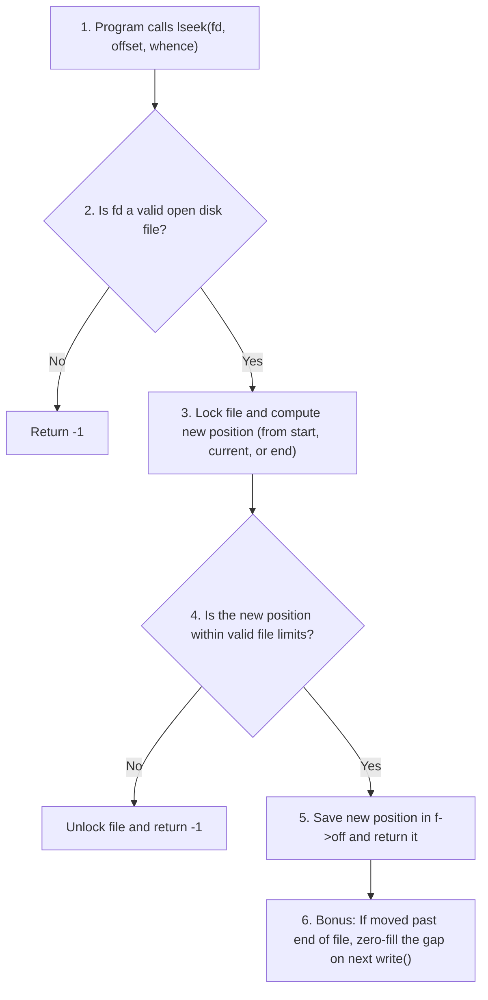

### How It Works

* **Three positioning modes (`kernel/fcntl.h`, `kernel/sysfile.c`):** `SEEK_SET` (from byte `0`), `SEEK_CUR` (relative to `f->off`), and `SEEK_END` (relative to `ip->size`).
* **Safe bounds checking:** Rejects negative final offsets or positions beyond `MAXFILE * BSIZE`, and rejects pipes/devices cleanly.

### Mini-Extension: Sparse Seek Past End-of-File

* When `lseek()` places the offset past the current end of a file, the next `write()` automatically **fills the skipped gap with zeros** in log-safe chunks (while preserving standard error checks if another process truncated the file).

### Live Demo & Output

```text
$ lseektest
lseektest: starting random-access file positioning test
[Test 1] SEEK_SET offset 4 -> patched "WXYZ"
[Test 2] SEEK_CUR +4 (offset 12) -> read "CDEF"
[Test 3] SEEK_END -12 (offset 4) -> verified "WXYZ"
[Test 4] Sparse seek past EOF -> 8 zero-filled gap bytes + "END!" (size=28)
lseektest: ALL TESTS PASSED
```

### Key Files

* `kernel/fcntl.h`, `kernel/file.h`, `kernel/file.c`, `kernel/sysfile.c`, `user/lseektest.c`

---

# 17. Symbolic Links (Shortcuts) — `symlink()`, `readlink()`, and `O_NOFOLLOW`

### In Simple Words

A **symbolic link** works just like a **desktop shortcut**: it is a small special file (`T_SYMLINK`) that stores the name of another file or path. Opening the shortcut automatically opens the target file — unless you ask not to follow it (`O_NOFOLLOW`), and our kernel stops infinite loops if two shortcuts point to each other.

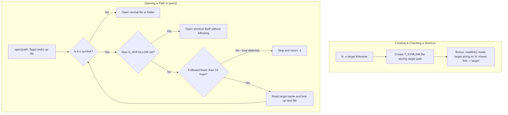

### How It Works

* **Create & inspect (`kernel/sysfile.c`, `user/ln.c`):** `ln -s target link` calls `symlink()`, storing the target string inside a `T_SYMLINK` inode.
* **Loop protection (`kernel/param.h`):** `open()` follows chained shortcuts up to `MAXSYMLINK` (`10`) hops and cleanly rejects broken links or circular loops.

### Mini-Extension: `readlink()` & Arrow Display in `ls`

* Adds **`readlink(path, buf, size)`** to read a shortcut's target path directly, and updates **`ls`** (using `O_NOFOLLOW`) to print symbolic links cleanly as `doclink -> README`.

### Live Demo & Output

```text
$ symlinktest
symlinktest: starting symbolic link verification
[Test 1] Chained symlink sym_link2 -> sym_link1 -> sym_target read "nexus-link"
[Test 2] readlink("sym_link1") = "sym_target" (O_NOFOLLOW type=T_SYMLINK)
[Test 3] Dangling symlink rejected cleanly
[Test 4] Symlink cycle caught cleanly (MAXSYMLINK guard)
symlinktest: ALL TESTS PASSED

$ ln -s README doclink
$ ls doclink
doclink -> README  4 45 6
```

### Key Files

* `kernel/stat.h`, `kernel/fcntl.h`, `kernel/param.h`, `kernel/sysfile.c`, `user/ln.c`, `user/ls.c`, `user/symlinktest.c`

---

# 18. User-Space Timer Alarms — `sigalarm()` and `sigreturn()`

### In Simple Words

`sigalarm()` lets a program set an **alarm clock** inside the OS: *"After every N timer ticks, pause whatever I'm doing, run my handler function, and then put me right back where I left off."* To make sure the interrupted program doesn't lose its place or scramble its CPU registers, the kernel saves a snapshot of its registers before running the handler and restores them on `sigreturn()`.

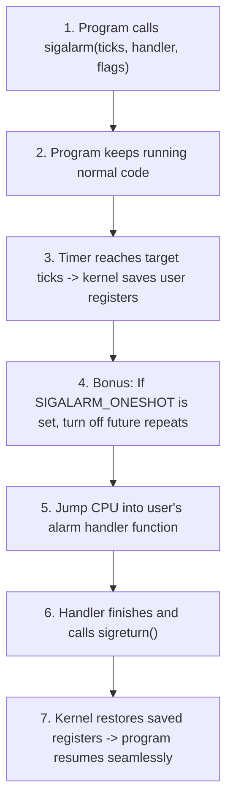

### How It Works

* **Register snapshot (`kernel/proc.h`, `kernel/trap.c`):** `usertrap()` saves `*(p->trapframe)` into `p->alarm_tf`, sets `alarm_active = 1` (preventing overlapping alarms), and jumps to `alarm_handler`.
* **Exact resume (`kernel/sysproc.c`):** `sys_sigreturn()` restores `p->alarm_tf` and returns `p->trapframe->a0` so not a single register is lost.
* **Clean across `exec()` (`kernel/exec.c`):** Clears any armed alarm when starting a new program.

### Mini-Extension: One-Shot Mode (`SIGALARM_ONESHOT`) & Remaining Ticks

* Supports **`SIGALARM_ONESHOT`** so a timer fires **only once** and disarms itself automatically, and makes `sigalarm()` return how many ticks were left on any previous alarm.

### Live Demo & Output

```text
$ alarmtest
alarmtest: starting user-space timer alarm verification
[Test 1] Periodic alarm delivered 4 signals (remaining=1 ticks)
[Test 2] Previous alarm remaining ticks returned: 20 / 20
[Test 3] SIGALARM_ONESHOT fired exactly once and auto-disarmed
alarmtest: ALL TESTS PASSED
```

### Key Files

* `kernel/param.h`, `kernel/proc.h`, `kernel/proc.c`, `kernel/exec.c`, `kernel/trap.c`, `kernel/sysproc.c`, `user/alarmtest.c`

---

# 19. File Descriptor Redirection — `dup2()` and `dup3()`

### In Simple Words

Normal `dup()` picks the next free file slot number automatically. `dup2(oldfd, newfd)` lets a program **place a file handle into an exact chosen slot number** (closing whatever was previously in `newfd` first) — the exact mechanism shells use to redirect input/output (`>` and `<`).

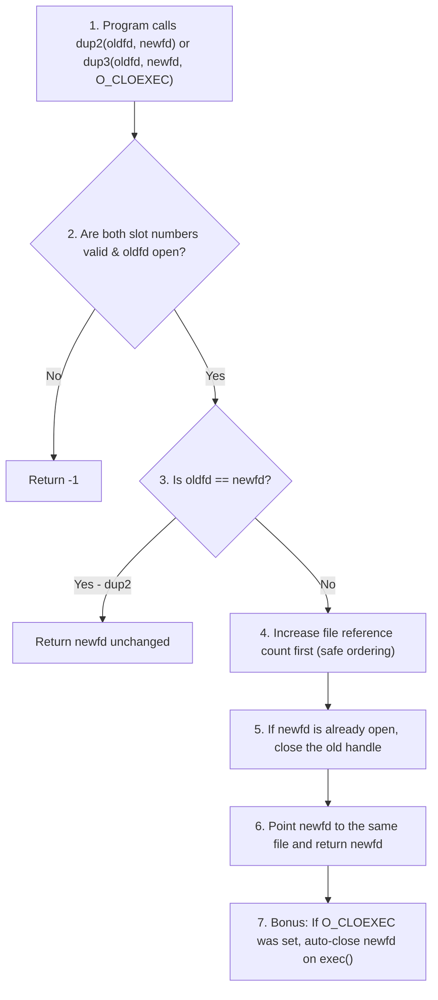

### How It Works

* **Safe ordering (`kernel/sysfile.c`):** `do_dup()` calls `filedup()` *before* closing any existing handle at `newfd`, so the underlying file is never accidentally freed prematurely.
* **Shared file offset:** Both `oldfd` and `newfd` point to the same kernel `struct file`, so writes advance one shared offset.

### Mini-Extension: Close-on-Exec Protection (`dup3` & `O_CLOEXEC`)

* Adds a per-process `fd_cloexec` bitmask and **`dup3(oldfd, newfd, O_CLOEXEC)`**: any handle marked `O_CLOEXEC` is **automatically closed during `exec()`**, keeping private handles from leaking into new programs.

### Live Demo & Output

```text
$ dup2test
dup2test: starting descriptor redirection verification
[Test 1] dup2(fd, 10) shared offset verified ("ABCD")
[Test 2] dup3(fd, 11, O_CLOEXEC) automatically closed fd 11 on exec()
dup2test: ALL TESTS PASSED
```

### Key Files

* `kernel/fcntl.h`, `kernel/proc.h`, `kernel/proc.c`, `kernel/exec.c`, `kernel/sysfile.c`, `user/dup2test.c`

---

# 20. Disk & Buffer Cache Diagnostics — `statfs()` and `df`

### In Simple Words

Just as `free` reports RAM health, **`df`** reports **hard-disk health**: how many disk blocks and file slots (inodes) are used vs. free, plus how efficiently our in-memory disk cache (`bcache`) is avoiding slow disk reads.

```mermaid
flowchart TD
    A["1. User runs 'df', 'df -c', or 'df -t'"] --> B["2. Program calls statfs() into kernel"]
    B --> C["3. Read disk size from superblock"]
    B --> D["4. Scan free-block bitmap (used vs. free blocks)"]
    B --> E["5. Scan inode table (used vs. free file slots)"]
    B --> F["6. Bonus: Read buffer-cache hit & miss counters"]
    C --> G["7. Combine into struct statfs and send to user space"]
    D --> G
    E --> G
    F --> G
    G --> H["8. Print disk usage, inode usage, and cache hit rate (%)"]
```

### How It Works

* **Live disk scan (`kernel/fs.c`):** `fsstat()` reads the superblock, scans the block allocation bitmap, and scans on-disk inode blocks to report exact usage.
* **Built-in verification (`user/df.c`):** `df -t` creates a test file, confirms used blocks and inodes increase, deletes it, and confirms counts recover.

### Mini-Extension: Buffer Cache Hit/Miss Telemetry (`df -c`)

* Tracks cache hits (block already in memory) vs. misses (disk read required) inside `bget()` (`kernel/bio.c`), allowing **`df -c`** to display the live buffer-cache hit rate percentage.

### Live Demo & Output

```text
$ df -c
Filesystem (ROOTDEV 1, block size 1024 B):
Total disk:   4000 KB (4000 blocks: 3953 data, 31 log)
Used disk:    1946 KB (1946 blocks, 48%)
Free disk:    2054 KB (2054 blocks)
Inodes:       45 used / 199 total (154 free, 22%)
Buffer cache: 749 hits / 225 misses (76% hit rate)

$ df -t
...
df: ALL TESTS PASSED
```

### Key Files

* `kernel/statfs.h`, `kernel/defs.h`, `kernel/bio.c`, `kernel/fs.c`, `kernel/sysfile.c`, `user/df.c`

---

# System Calls Added (23 – 53)

| System Call         | Number | Module | Purpose                                                |
| ------------------- | -----: | -----: | ------------------------------------------------------ |
| `ps()`              |     23 |      1 | Display active entries in the kernel process table     |
| `setpriority()`     |     24 |      2 | Change process scheduling priority (`1..20`)           |
| `mmap()`            |     25 |      5 | Create a lazy file-backed or anonymous mapping         |
| `munmap()`          |     26 |      5 | Unmap pages and write back `MAP_SHARED` modifications  |
| `trace()`           |     27 |      6 | Configure per-process system-call trace bitmask        |
| `sysinfo()`         |     28 |      7 | Query RAM, shared COW pages, open files, procs, uptime |
| `getppid()`         |     29 |      8 | Return calling process's parent PID                    |
| `ptree()`           |     30 |      8 | Display hierarchical parent-child process tree         |
| `getsyscallcount()` |     31 |     10 | Return per-process invoked system-call count           |
| `waitx()`           |     32 |     11 | Reap child and return wait, CPU ticks, & ctx switches  |
| `halt()`            |     33 |     12 | Cleanly power off the QEMU RISC-V virtual machine      |
| `reboot()`          |     34 |     12 | Cleanly restart the QEMU RISC-V virtual machine        |
| `sched_yield()`     |     35 |     13 | Voluntarily yield CPU slice and return yield count     |
| `getcpuid()`        |     36 |     14 | Return executing RISC-V hardware thread (hart) ID      |
| `setprocname()`     |     37 |     15 | Dynamically update the calling process's name          |
| `getpriority()`     |     38 |      2 | Query a process's current base priority                |
| `getcowfaults()`    |     39 |      4 | Query per-process Copy-on-Write fault count            |
| `tracemode()`       |     40 |      6 | Enable `strace -e` (errors) or `strace -c` (summary)   |
| `setaging()`        |     41 |      9 | Query or tune runtime priority aging threshold         |
| `syscallstats()`    |     42 |     10 | Print per-syscall breakdown & top calls (`syscount -v`)|
| `setaffinity()`     |     43 |     14 | Pin a process to specific RISC-V cores (harts)         |
| `getprocname()`     |     44 |     15 | Copy a process's runtime name back to user space       |
| `findproc()`        |     45 |     15 | Find active PIDs matching a process name (`pidof`)     |
| `lseek()`           |     46 |     16 | Reposition read/write file offset (`SEEK_SET/CUR/END`) |
| `symlink()`         |     47 |     17 | Create a symbolic link (`T_SYMLINK`) to a target path  |
| `readlink()`        |     48 |     17 | Read raw target string from a symbolic link            |
| `sigalarm()`        |     49 |     18 | Register a periodic or one-shot user alarm handler     |
| `sigreturn()`       |     50 |     18 | Restore saved trapframe after user alarm handler runs  |
| `dup2()`            |     51 |     19 | Atomically duplicate a file descriptor onto `newfd`    |
| `dup3()`            |     52 |     19 | Duplicate descriptor with `O_CLOEXEC` flag support     |
| `statfs()`          |     53 |     20 | Query disk block, inode, and buffer-cache statistics   |

---

# Building & Running

NexusXv6 builds and runs on **WSL2 (Ubuntu)** with `build-essential`, `gcc-riscv64-unknown-elf`, `qemu-system-misc` / `qemu-system-riscv`, `perl`, and `bc`:

```bash
cd /mnt/d/xv6-riscv   # or your cloned xv6-riscv directory
make clean
make
make qemu
```

Inside the NexusXv6 shell (`$`):

```text
$ ps
$ pstree
$ free -m
$ df -c
$ df -t
$ setpriority 2 5
$ agetest
$ cowtest
$ mmaptest
$ strace -c echo hello
$ syscount -v 2
$ time cpuburn 2
$ yieldtest
$ cpuinfo
$ renametest
$ pidof sh
$ lseektest
$ symlinktest
$ alarmtest
$ dup2test
$ usertests -q
$ shutdown
```

For step-by-step evaluator instructions and expected outputs for all 20 modules, see **[USER_MANUAL.md](USER_MANUAL.md)**.

---

# Documentation

* **[README.md](README.md)** — Architecture, clear Mermaid diagrams, all 20 kernel modules, and their 20 mini-extensions
* **[USER_MANUAL.md](USER_MANUAL.md)** — Step-by-step build, command reference, and verification guide
