# NexusXv6

### Extended xv6-RISC-V Kernel

NexusXv6 is an extended version of the MIT `xv6-riscv` teaching operating system. It expands the baseline kernel with **15 modular kernel extensions** spanning process inspection, priority scheduling with anti-starvation aging, CPU and system-call accounting, execution benchmarking, Copy-on-Write (COW) virtual memory, demand-paged file mappings, system-call tracing, system resource diagnostics, multi-core HART introspection, cooperative yielding, dynamic process naming, and MMIO-driven power management.

The implementation targets **64-bit RISC-V (`rv64gc`)** and runs on **QEMU (`virt` machine, SMP)** under **WSL2 / Ubuntu**.

---

## Features

NexusXv6 implements fifteen major kernel extensions:

1. **Process inspection with `ps`**
2. **Priority-based CPU scheduling**
3. **Per-process CPU-time accounting**
4. **Copy-on-Write (COW) memory management**
5. **Memory mapping with `mmap()` and `munmap()`**
6. **System call tracing with `trace()` and `strace`**
7. **System resource diagnostics with `sysinfo()` and `free`**
8. **Parent process inspection with `getppid()` and `pstree`**
9. **Priority aging for starvation prevention**
10. **Per-process system call accounting with `getsyscallcount()`**
11. **Process execution benchmarking with `waitx()` and `time`**
12. **Clean system power management with `halt()` and `reboot()`**
13. **Voluntary CPU yielding with `sched_yield()`**
14. **Multi-core HART identification with `getcpuid()`**
15. **Dynamic process naming with `setprocname()`**

All fifteen extensions preserve original xv6 interfaces and compatibility with the standard `usertests` suite.

---

## Project Structure

```text
NexusXv6/
├── kernel/
│   ├── proc.h          # Process, VMA, scheduling, accounting, and tracing fields
│   ├── proc.c          # Scheduler, aging, fork/exit, waitx, ps, pstree, syscount
│   ├── syscall.h       # System call numbers (1..37)
│   ├── syscall.c       # Syscall dispatch, counting, and live trace logging
│   ├── sysproc.c       # Process, memory, benchmark, CPU, and power syscalls
│   ├── sysinfo.h       # struct sysinfo definition shared with user space
│   ├── trap.c          # Timer tick accounting, COW faults, mmap faults
│   ├── vm.c            # Page tables, COW fork/faults, mmap demand paging, MMIO map
│   ├── kalloc.c        # Physical page allocator, COW refcounts, free RAM metrics
│   ├── memlayout.h     # Physical/virtual memory layout including VIRT_TEST MMIO
│   ├── riscv.h         # RISC-V CSRs and PTE flags (including PTE_COW)
│   ├── param.h         # Kernel parameters, AGING_THRESHOLD, mmap flags
│   └── defs.h          # Internal kernel function prototypes
│
├── user/
│   ├── ps.c            # Process table viewer
│   ├── setpriority.c   # Priority configuration utility
│   ├── cpuburn.c       # CPU-bound workload generator
│   ├── cowtest.c       # Copy-on-Write verification test
│   ├── mmaptest.c      # Shared/private mmap verification test
│   ├── strace.c        # Live system-call tracer command
│   ├── free.c          # Physical memory & process diagnostics utility
│   ├── pstree.c        # Parent PID & hierarchical process tree viewer
│   ├── agetest.c       # Anti-starvation priority aging verification test
│   ├── syscount.c      # Per-process system-call counter utility
│   ├── time.c          # Command execution benchmark utility (waitx)
│   ├── shutdown.c      # Clean system power-off command
│   ├── reboot.c        # Clean system restart command
│   ├── yieldtest.c     # Cooperative CPU yielding verification test
│   ├── cpuinfo.c       # Multi-core RISC-V HART inspection utility
│   ├── renametest.c    # Dynamic process renaming verification test
│   ├── user.h          # User-space system call & library declarations
│   └── usys.pl         # System call assembly stub generator
│
├── Makefile
├── README.md
└── USER_MANUAL.md
```

---

## System Architecture

The diagram below illustrates how user-space utilities interact with all fifteen NexusXv6 kernel extensions across the trap/syscall boundary down to RISC-V hardware and QEMU devices.

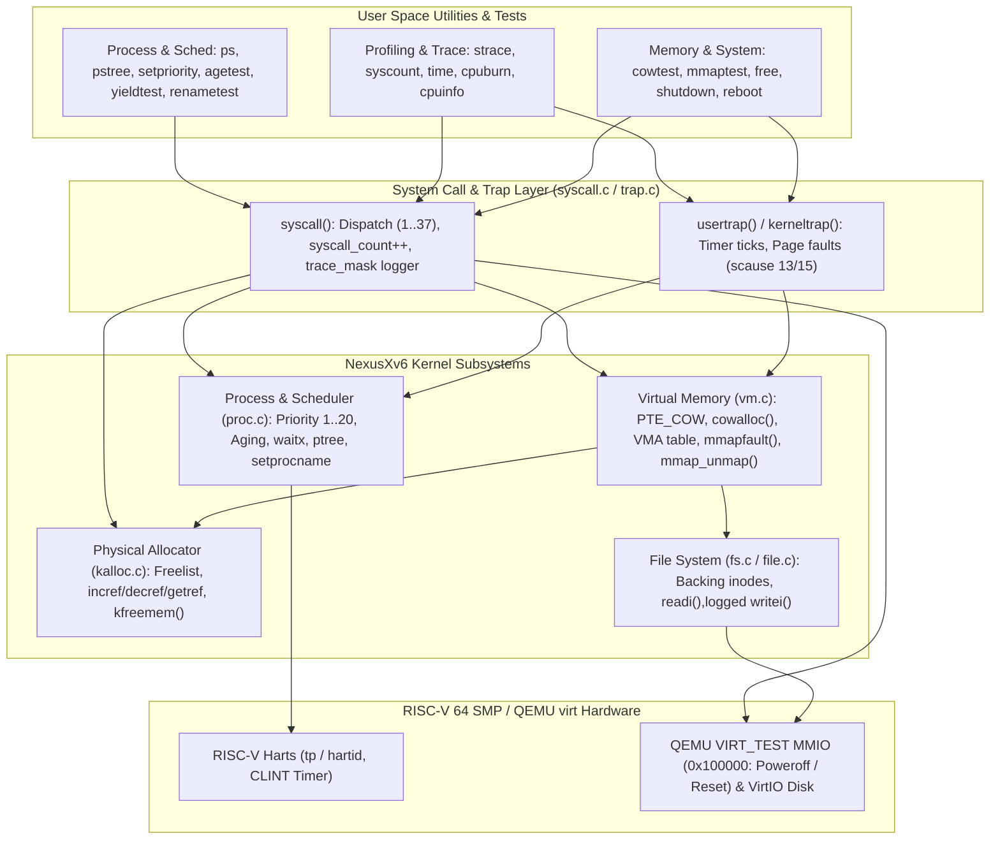

---

# 1. Process Inspection — `ps`

A `ps()` system call (`SYS_ps = 23`) displays active entries in the kernel process table (`proc[NPROC]`).

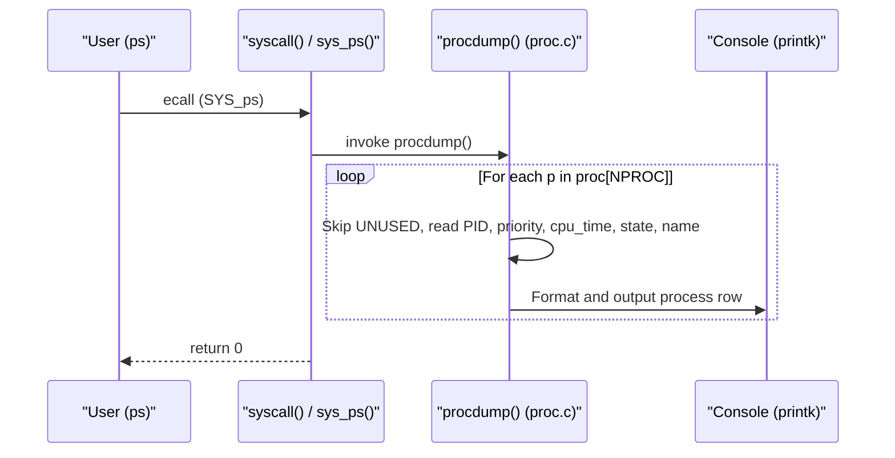

### Displayed Information

```text
PID   PRIORITY   CPU-TICKS   STATE     NAME
1     10         2           sleep     init
2     10         5           sleep     sh
3     10         0           run       ps
```

### Relevant Files

* `kernel/syscall.h`, `kernel/syscall.c`, `kernel/sysproc.c`, `kernel/proc.c`, `user/ps.c`

---

# 2. Priority-Based Scheduler

The baseline round-robin scheduler is extended with priority levels from `1` (highest priority) to `20` (lowest priority), with default priority `10` assigned in `allocproc()`.

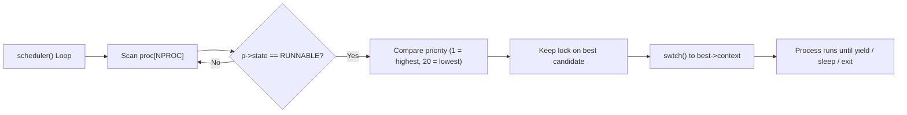

### Changing Priority

```text
$ setpriority 2 5
Process 2 priority set to 5
```

Values outside `1..20` are rejected with `-1` in `sys_setpriority()`.

### Relevant Files

* `kernel/proc.h`, `kernel/proc.c`, `kernel/sysproc.c`, `user/setpriority.c`

---

# 3. Per-Process CPU-Time Accounting

Each process maintains `uint64 cpu_time` in `struct proc`, initialized to `0` at allocation and incremented whenever a hardware timer interrupt (`which_dev == 2`) preempts the running process in `usertrap()` or `kerneltrap()`.

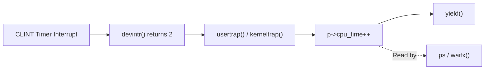

### Example

```text
$ cpuburn &
$ ps
PID   PRIORITY   CPU-TICKS   STATE     NAME
4     10         84          runble    cpuburn
```

### Relevant Files

* `kernel/proc.h`, `kernel/proc.c`, `kernel/trap.c`, `user/cpuburn.c`

---

# 4. Copy-on-Write (COW) Memory Management

During `fork()`, `uvmcopy()` avoids duplicating writable physical pages. Instead, parent and child map the same physical frame read-only with `PTE_COW` (`1L << 8`) and increment its reference count in `kalloc.c`.

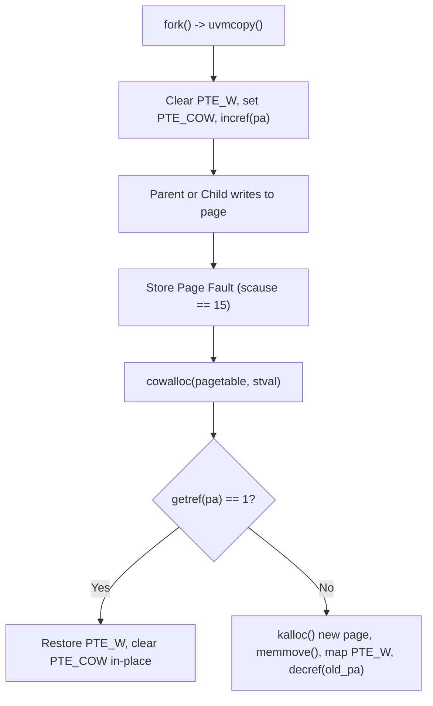

### Key Mechanisms

* **Reference Counting (`kernel/kalloc.c`):** `incref()`, `getref()`, and `decref()` ensure shared frames are freed only when their reference count reaches `0`.
* **Kernel Writes (`copyout()`):** Checks `PTE_COW` and triggers `cowalloc()` before copying kernel data to user pages.

### Relevant Files

* `kernel/riscv.h`, `kernel/kalloc.c`, `kernel/vm.c`, `kernel/trap.c`, `user/cowtest.c`

---

# 5. Memory Mapping — `mmap()` and `munmap()`

NexusXv6 supports lazy file-backed virtual memory mappings via per-process Virtual Memory Areas (`struct vma vmas[NVMA]`, `NVMA = 16`) with `PROT_READ`, `PROT_WRITE`, `MAP_SHARED`, and `MAP_PRIVATE`.

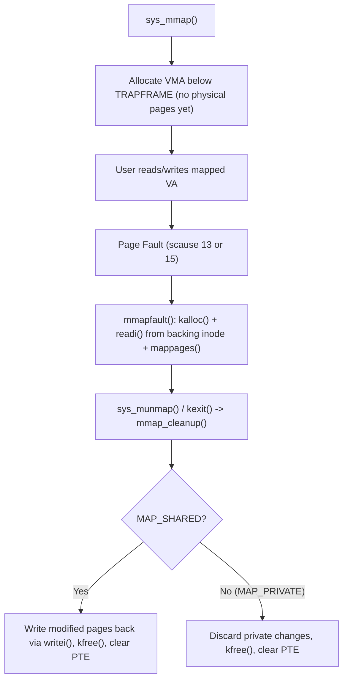

### Relevant Files

* `kernel/param.h`, `kernel/proc.h`, `kernel/proc.c`, `kernel/sysproc.c`, `kernel/vm.c`, `kernel/trap.c`, `user/mmaptest.c`

---

# 6. System Call Tracing — `trace()` and `strace`

Processes can enable selective or full system-call tracing via `trace(uint64 mask)` (`SYS_trace = 27`). Each process stores `uint64 trace_mask` in `struct proc`, which is inherited across `fork()` so child processes are traced seamlessly.

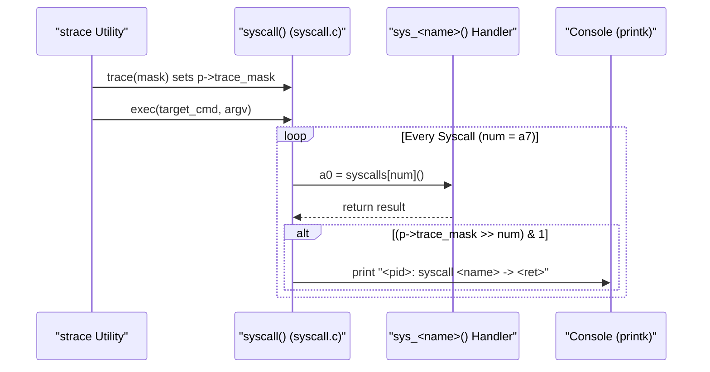

### Example

```text
$ strace -a echo hello
4: syscall exec -> 2
hello
4: syscall write -> 5
4: syscall write -> 1
```

### Relevant Files

* `kernel/proc.h`, `kernel/proc.c`, `kernel/syscall.h`, `kernel/syscall.c`, `kernel/sysproc.c`, `user/strace.c`

---

# 7. System Resource Diagnostics — `sysinfo()` and `free`

The `sysinfo(struct sysinfo *)` system call (`SYS_sysinfo = 28`) aggregates live kernel memory, process-table, and uptime metrics into a single user-space structure defined in `kernel/sysinfo.h`.

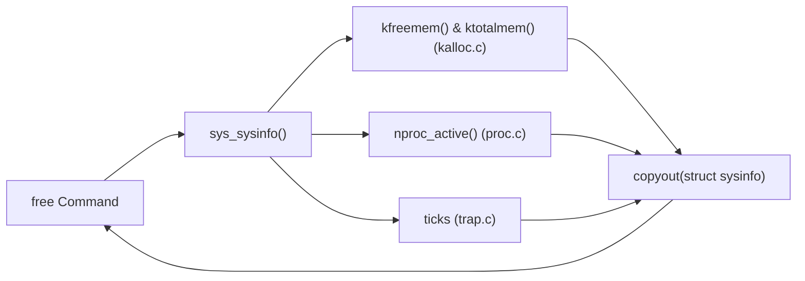

### Example

```text
$ free
Total memory:  130940 KB (32735 pages)
Used memory:   324 KB (81 pages)
Free memory:   130616 KB (32654 pages)
Active procs:  3 / 64
System uptime: 42 ticks
```

### Relevant Files

* `kernel/sysinfo.h`, `kernel/kalloc.c`, `kernel/proc.c`, `kernel/sysproc.c`, `user/free.c`

---

# 8. Parent Process Inspection — `getppid()` and `pstree`

NexusXv6 adds `getppid()` (`SYS_getppid = 29`) to retrieve the calling process's parent PID under `wait_lock`, along with `ptree()` (`SYS_ptree = 30`) to snapshot the process table and render the parent-child hierarchy.

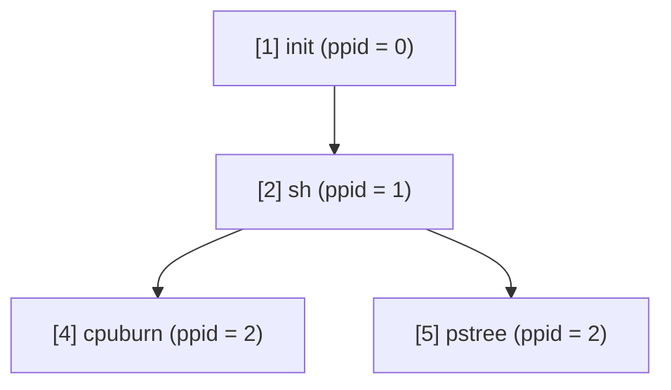

### Example

```text
$ pstree
Current PID: 5 | Parent PID: 2
Process Hierarchy:
[1] init (prio=10, state=sleep )
  |-- [2] sh (prio=10, state=sleep )
    |-- [5] pstree (prio=10, state=run   )
```

### Relevant Files

* `kernel/proc.c`, `kernel/sysproc.c`, `kernel/syscall.h`, `user/pstree.c`

---

# 9. Priority Aging for Starvation Prevention

Static priority scheduling can starve low-priority (`priority = 20`) processes when higher-priority CPU-bound tasks stay runnable. NexusXv6 prevents starvation using dynamic **priority aging** in `scheduler()`.

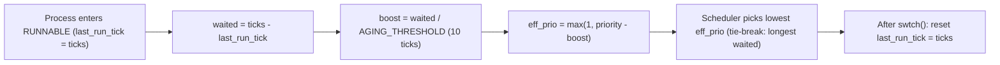

### Key Properties

* **Base priority preserved:** `p->priority` remains unchanged (`ps` still shows the user-configured priority), while `eff_prio` improves the longer a process waits in `RUNNABLE`.
* **Verified under full SMP load:** `agetest` saturates all CPU harts with `priority = 3` hogs and verifies that a `priority = 20` worker still completes.

### Relevant Files

* `kernel/param.h`, `kernel/proc.h`, `kernel/proc.c`, `user/agetest.c`

---

# 10. Per-Process System Call Accounting — `getsyscallcount()`

Every valid system call increments `p->syscall_count` in `syscall()`. User space can query its own count (`getsyscallcount(0)`) or inspect another process by PID (`getsyscallcount(pid)` via `SYS_getsyscallcount = 31`).

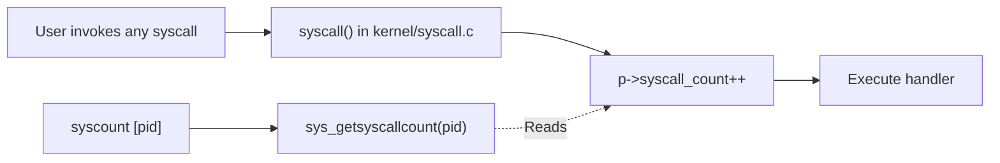

### Example

```text
$ syscount 2
Process 2 total syscalls: 28
```

### Relevant Files

* `kernel/proc.h`, `kernel/proc.c`, `kernel/syscall.c`, `kernel/sysproc.c`, `user/syscount.c`

---

# 11. Process Execution Benchmarking — `waitx()` and `time`

Each process records its creation tick (`p->ctime = ticks`) in `allocproc()`. The `waitx(&status, &wtime, &rtime)` system call (`SYS_waitx = 32`) reaps an exited child while reporting both **active CPU ticks (`rtime`)** and **non-running wait/sleep ticks (`wtime`)**.

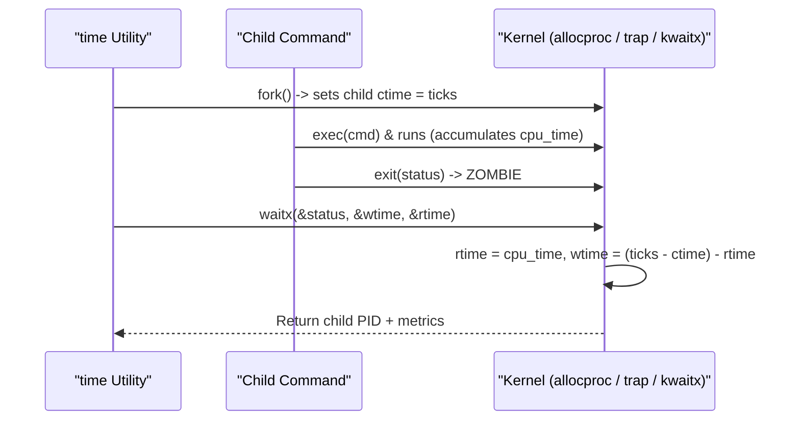

### Example

```text
$ time cowtest
Original: A
After child 1: A
After child 2: A
--- Benchmark: cowtest (PID 6) ---
Elapsed ticks: 3
CPU ticks:     1
Wait ticks:    2
Exit status:   0
```

### Relevant Files

* `kernel/proc.h`, `kernel/proc.c`, `kernel/sysproc.c`, `user/time.c`

---

# 12. Clean System Power Management — `halt()` and `reboot()`

NexusXv6 maps QEMU's SiFive test/power finisher MMIO register (`VIRT_TEST = 0x100000L`) into the kernel page table during `kvmmake()`. Two system calls—`halt()` (`SYS_halt = 33`) and `reboot()` (`SYS_reboot = 34`)—flush filesystem state via `sync()` in user space and signal QEMU cleanly.

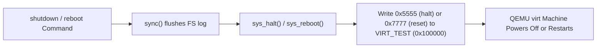

### Example

```text
$ shutdown
Shutting down NexusXv6...
System halting...
```

### Relevant Files

* `kernel/memlayout.h`, `kernel/vm.c`, `kernel/sysproc.c`, `user/shutdown.c`, `user/reboot.c`

---

# 13. Voluntary CPU Yielding — `sched_yield()`

The `sched_yield()` system call (`SYS_sched_yield = 35`) exposes the kernel's `yield()` mechanism to user space, allowing cooperative processes to voluntarily transition from `RUNNING` to `RUNNABLE` without waiting for timer expiration.

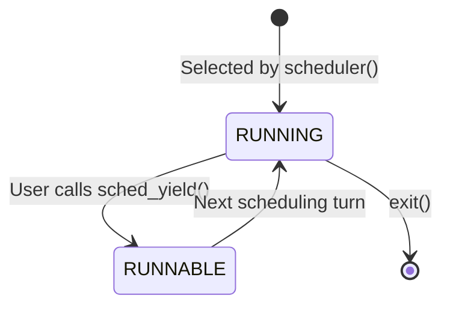

### Example

```text
$ yieldtest
yieldtest: starting cooperative CPU yield test
Worker A (PID 4): step 1 -> sched_yield()
Worker B (PID 5): step 1 -> sched_yield()
...
yieldtest: ALL TESTS PASSED
```

### Relevant Files

* `kernel/sysproc.c`, `kernel/proc.c`, `user/yieldtest.c`

---

# 14. Multi-Core HART Identification — `getcpuid()`

QEMU boots NexusXv6 as a symmetric multiprocessor (`CPUS = 3` by default: `hart 0`, `hart 1`, `hart 2`). `getcpuid()` (`SYS_getcpuid = 36`) disables interrupts via `push_off()`, reads the RISC-V `tp` register through `cpuid()`, re-enables interrupts via `pop_off()`, and returns the executing hardware thread ID.

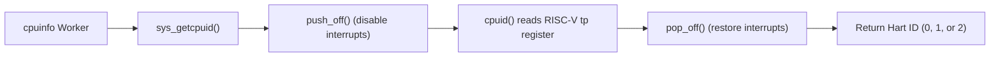

### Example

```text
$ cpuinfo
Parent (PID 4) running on RISC-V hart 0
Worker 0 (PID 5) executing on RISC-V hart 1
Worker 1 (PID 6) executing on RISC-V hart 2
Worker 2 (PID 7) executing on RISC-V hart 0
```

### Relevant Files

* `kernel/sysproc.c`, `kernel/proc.c`, `user/cpuinfo.c`

---

# 15. Dynamic Process Naming — `setprocname()`

The `setprocname(const char *name)` system call (`SYS_setprocname = 37`) safely copies a non-empty user string into `p->name` under `p->lock`, enabling worker processes and daemons to update their descriptive names dynamically at runtime.

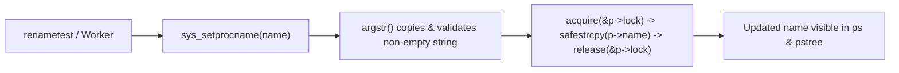

### Example

```text
$ renametest
renametest (PID 5): before setprocname()
...
5   10   0   run   renametest

renametest (PID 5): after setprocname("nexus_worker")
...
5   10   0   run   nexus_worker
renametest: ALL TESTS PASSED
```

### Relevant Files

* `kernel/sysproc.c`, `kernel/proc.h`, `user/renametest.c`

---

# System Calls Added

| System Call         | Number | Purpose                                           |
| ------------------- | -----: | ------------------------------------------------- |
| `ps()`              |     23 | Display process table information                 |
| `setpriority()`     |     24 | Change process scheduling priority (`1..20`)      |
| `mmap()`            |     25 | Create a lazy file-backed memory mapping          |
| `munmap()`          |     26 | Unmap a memory-mapped region                      |
| `trace()`           |     27 | Configure per-process system-call trace bitmask   |
| `sysinfo()`         |     28 | Query free/total RAM, active processes, & uptime  |
| `getppid()`         |     29 | Return parent process ID                          |
| `ptree()`           |     30 | Display hierarchical parent-child process tree    |
| `getsyscallcount()` |     31 | Return per-process invoked system-call count      |
| `waitx()`           |     32 | Reap child and return wait ticks & CPU ticks      |
| `halt()`            |     33 | Cleanly power off the QEMU RISC-V machine         |
| `reboot()`          |     34 | Cleanly restart the QEMU RISC-V machine           |
| `sched_yield()`     |     35 | Voluntarily yield the current CPU time slice      |
| `getcpuid()`        |     36 | Return executing RISC-V hardware thread (hart) ID |
| `setprocname()`     |     37 | Dynamically rename the calling process            |

---

# Building & Running

NexusXv6 requires **WSL2 (Ubuntu)** with `build-essential`, `gcc-riscv64-unknown-elf`, `qemu-system-riscv`, and `bc`:

```bash
cd /mnt/c/Kernel/xv6-riscv
make clean
make
make qemu
```

Inside the xv6 shell (`$`):

```text
$ ps
$ pstree
$ free
$ setpriority 2 5
$ agetest
$ cowtest
$ mmaptest
$ strace -a echo hello
$ syscount
$ time cowtest
$ yieldtest
$ cpuinfo
$ renametest
$ usertests
$ shutdown
```

For step-by-step evaluator instructions and expected outputs for every module, see **[USER_MANUAL.md](USER_MANUAL.md)**.

---

# Documentation

* **[README.md](README.md)** — Architecture, diagrams, and implementation details for all 15 extensions
* **[USER_MANUAL.md](USER_MANUAL.md)** — Step-by-step build, command reference, and evaluation guide
